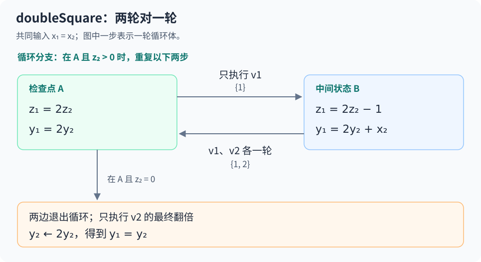
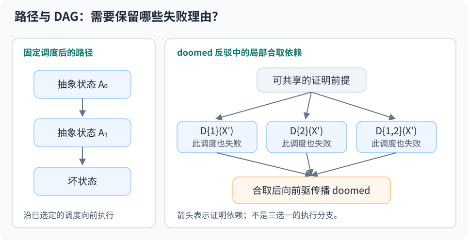
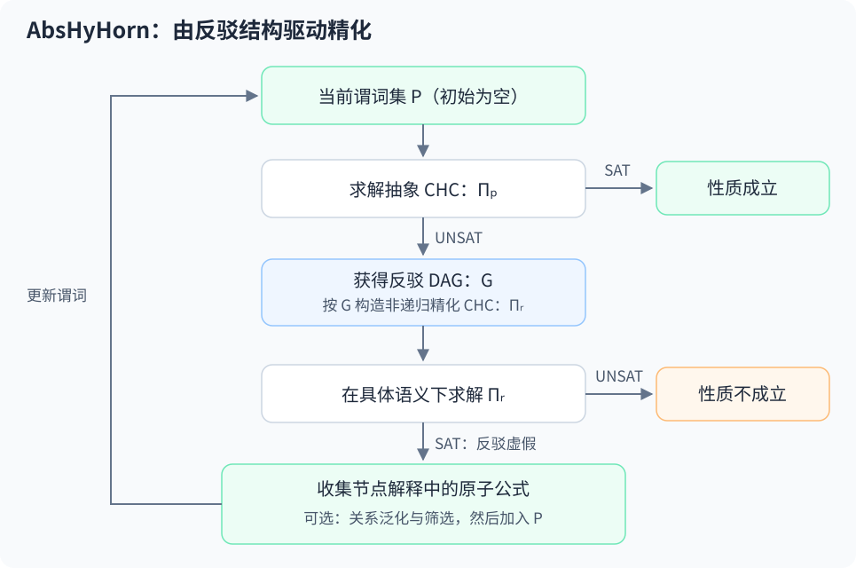

证明两个程序给出相同结果，有时比证明它们各自算出了什么更容易。前提是，要在合适的位置比较它们。

这篇笔记放在一起读两篇论文：

- **Automated Property Directed Self Composition**，Akshatha Shenoy、Sumanth Prabhu、Kumar Madhukar、Ron Shemer、Mandayam Srivas，ATVA 2023。下文按工具名记作 **PdscSynth**。[^pdscsynth]
- **Automatic Abstraction Refinement for Hyperproperties Verification**，Malak Marrid、Shachar Itzhaky、Sharon Shoham、Yakir Vizel，IJCAR 2026。下文按工具名记作 **AbsHyHorn**。[^abshyhorn]

两篇都试图省掉人工提供抽象谓词的工作。不过，它们内部处理的验证问题和反例形状不同。读下来，我觉得最需要弄清楚的是：**执行怎样对齐，决定了需要什么不变式；抽象能表达什么关系，又限制了可以找到什么对齐。**

## 1. 从“两次执行”开始

普通安全性质只看一条执行，例如“数组访问不越界”。超性质（hyperproperty）讨论一组执行之间的关系。以终止时的非干涉为例：初始公开输入相同的两次执行，即使秘密输入不同，最终公开输出也应相同。

$$
\mathrm{lowIn}_1=\mathrm{lowIn}_2
\quad\Longrightarrow\quad
\mathrm{lowOut}_1=\mathrm{lowOut}_2.
$$

单独拿出一条执行，并不能判断输出是否泄露了秘密；需要另一条执行来比较。程序等价性也有相同的结构：输入满足对应关系时，两个程序的输出是否相等？

这里主要关心 $k$-safety：违反性质可以由至多 $k$ 条执行的有限前缀见证。它是超安全性质中可以用固定数量执行讨论的一类，不能把所有超性质都直接称为 $k$-safety。第一篇集中处理这种关系安全性问题；第二篇还处理带存在轨迹量词的一个片段。

自组合（self composition）的做法是复制程序，给每份副本使用互不相交的变量，再把关系性质写成组合程序上的普通安全性质。例如，两个副本分别使用 $(x_1,y_1)$ 和 $(x_2,y_2)$，在入口约束 $x_1=x_2$，在出口检查 $y_1=y_2$。

问题在于，“组合”并没有指定两份程序必须按什么顺序执行。先跑完第一份再跑第二份、每次各走一步、某一份多走一步，都可能对应同一组原程序执行，却带来难度很不一样的证明义务。这里的调度是验证时组织执行的方式，并不是给原程序增加线程。

:::note[调度不能让坏执行凭空消失]
副本互不干扰，是调整交错顺序的基础，但还需要满足相应框架的调度约束。不能让某个副本永远停住，借此避开终止检查或观察点。第一篇围绕终止状态的前后置条件展开；第二篇显式规定观察点处的合法调度。两者的语义不能直接混用。
:::

## 2. doubleSquare：换一种对齐，非线性关系就不必出现

PdscSynth 第 2 节的例子很适合说明这个问题。下面保留原例的计算方式，显式写出两份副本的变量；为方便按循环次数推导，先取共同输入 $x_1=x_2=x\geq 0$，并采用数学整数语义，不考虑机器整数溢出。

```c
// v1：累加 2*x 次
y1 = 0;
z1 = 2 * x1;
while (z1 > 0) {
    z1 = z1 - 1;
    y1 = y1 + x1;
}
return y1;
```

```c
// v2：累加 x 次，最后翻倍
y2 = 0;
z2 = x2;
while (z2 > 0) {
    z2 = z2 - 1;
    y2 = y2 + x2;
}
y2 = 2 * y2;
return y2;
```

两者都返回 $2x^2$。如果分别求出循环摘要，再比较最终结果，很自然会得到：

$$
y_1=x(2x-z_1),\qquad y_2=x(x-z_2).
$$

这些等式含有变量乘积。对于只擅长线性算术的验证器，例子虽然短，证明却不轻松。

换一个比较位置：**v1 每执行两轮，v2 执行一轮。** 此时可以在检查点维护

$$
A:\quad x_1=x_2\ \land\ z_1=2z_2\ \land\ y_1=2y_2.
$$

这个关系只涉及线性算术。不过，工具不能只知道两轮结束后的关系，还要能描述中间那一步。沿用论文第 3.5 节的组合方式，先只执行 v1 一轮，得到

$$
B:\quad x_1=x_2\ \land\ z_1=2z_2-1\ \land\ y_1=2y_2+x_2.
$$

再让 v1、v2 各执行一轮，便回到 $A$。例如 $y$ 的更新满足

$$
y'_1=y_1+x_1=2y_2+2x_2=2y'_2.
$$



在 $A$ 且 $z_2>0$ 时，$z_1=2z_2\geq 2$，上面的两步循环都可以执行。到达 $A$ 且 $z_2=0$ 时，$z_1$ 也为零，两边退出循环。此时只需执行 v2 的最后一次翻倍，原来的 $y_1=2y_2$ 就变成输出相等。

这里展示的是循环边界处的数据关系。完整归纳不变式还要结合控制位置，区分循环内部、循环退出和最终返回，不能把 $y_1=2y_2$ 当成全程都成立的断言。$x<0$ 时两个循环都不进入、都返回零，也应另作入口分支处理，不能继续套用“循环执行 $x$ 次”的解释。

我更愿意把这个例子的收益理解成：我们没有分别恢复两份程序的完整函数语义，而是保留了足以比较它们的中间关系。

## 3. PdscSynth：当前语言证明不了，再去补谓词

### 3.1 PDSC 同时搜索什么

PdscSynth 建立在 2019 年的 Property Directed Self Composition（PDSC）之上。[^pdsc] PDSC 搜索的是一对对象：组合函数 $f$ 和关系归纳不变式 $\mathrm{Inv}$。

组合函数根据当前组合状态，选择下一步推进哪些副本：

$$
f:S^k\longrightarrow 2^{\{1,\ldots,k\}}\setminus\{\varnothing\}.
$$

它可以依据数据关系作选择，因此不局限于“两个循环长得一样，就把循环头对齐”。在给定合法组合 $f$ 后，证明义务仍是熟悉的三项：

$$
\begin{aligned}
\mathrm{pre}&\Rightarrow\mathrm{Inv},\\
\mathrm{Inv}\land R_f&\Rightarrow\mathrm{Inv}',\\
\mathrm{Inv}\land F^k&\Rightarrow\mathrm{post}.
\end{aligned}
$$

其中 $R_f$ 是按 $f$ 组合后的转移关系，$F^k$ 表示所有副本都已终止。

为了限制搜索空间，PDSC 要求用户给定谓词集合 $\mathcal P$，组合和不变式都在这些谓词形成的布尔语言中表达。比如上例需要区分 $A$ 和 $B$，就要能表达 $z_1=2z_2$、$z_1=2z_2-1$ 等关系。源码里并没有这些跨副本的等式，单靠收集程序中的条件表达式不够。

谓词抽象会把这些公式的真假作为状态信息：两个具体状态若对所有谓词的取值都相同，就被归到同一个抽象状态。谓词太少会把本应区分的状态混在一起，产生虚假路径；谓词太多又会增大搜索空间。若有 $m$ 个谓词，仅布尔取值组合就最多有 $2^m$ 种。

### 3.2 外层精化与内层组合搜索

原 PDSC 在当前谓词语言中找不到证明时，会报告“这个语言里没有证明”。这既可能是性质不成立，也可能只是语言缺少必要关系。PdscSynth 为它补上反例检查和谓词合成。

论文 Algorithm 2 的顺序值得保留：

1. 从 lockstep 组合开始，用当前 $\mathcal P$ 做谓词抽象并检查安全性。
2. 失败后先阻塞当前组合，尝试尚未阻塞的组合。
3. 当当前语言中的组合选择都被阻塞，再检查抽象反例是否有真实执行对应。
4. 找到真实反例就返回；否则生成新谓词，扩大 $\mathcal P$。
5. **清空已阻塞组合，重新从 lockstep 搜索。**

最后一步很合理：旧组合失败的原因可能只是缺少谓词。语言变了，原来被排除的组合也可能出现简单证明。

这与“给固定的自组合程序套一个 CEGAR 循环”有区别。PdscSynth 内部仍然会改组合。它的特点是先在当前语言里搜索组合，再由外层精化扩充语言。

### 3.3 三种谓词来源，差异不只在求解器

论文比较了 SyGuS、量词消去（QE）和插值三条路线。

对局部虚假转移 $A_{\mathrm{src}}\xrightarrow{R_f}A_{\mathrm{tgt}}$，前两条路线寻找解释条件 $p(X)$，使得

$$
p(X)\land A_{\mathrm{src}}(V)\land R_f(V,V')
\Rightarrow \neg A_{\mathrm{tgt}}(V').
$$

同时，左侧必须可满足，否则取 $p=\mathrm{false}$ 就能得到毫无用途的“解”。这是一个溯因（abduction）问题：补上什么条件，才能解释这条边为什么不应发生？

| 路线 | 如何得到谓词 | 论文中观察到的代价 |
| --- | --- | --- |
| SyGuS | 用 CVC4 1.8，在给定语法中合成解释条件 | 表达式往往较短，但枚举搜索可能超时 |
| QE | 用 Z3 对通向目标状态的条件做变量消去 | 能处理更多样例，但得到的表达式可能很大 |
| 插值 | 检查整条反例路径，从不可满足性证明提取序列插值 | 实验覆盖最好，仍需控制每轮加入的谓词数量 |

QE 路线可以理解成投影后排除：

$$
p(X)=\neg\exists\bigl((V\cup V')\setminus X\bigr).
\bigl(A_{\mathrm{src}}\land R_f\land A_{\mathrm{tgt}}\bigr).
$$

如果抽象语言允许任意布尔组合，那么加入 $p$ 或 $\neg p$ 的表达能力相同，所以论文实现不必额外保留外层否定。

还有一个容易漏掉的差别。SyGuS/QE 路线的检查从某个具体初态出发，沿抽象路径尝试推进。**这一次具体化走不通，不代表整条抽象路径没有其他可行具体化。** 插值路线则把整条路径编码后交给求解器：路径公式为 SAT，才提取真实反例；为 UNSAT，才使用不可行性证明生成谓词。这也解释了为什么在一些不安全样例上，插值版本不用加谓词就能发现反例，而另外两种版本还会先做精化。

### 3.4 理论上的进展与实现中的取舍

第 5.2 节给出的溯因精化有进展保证：新谓词消除相应虚假反例，并严格增强证明语言。但一般问题不可判定，这不等于算法总会终止。

第 5.3 节的插值实现又做了一个取舍：实验中每轮最多加入两个谓词，优先选择能关联此前未关联变量、较短且逻辑上较强的表达式，也可能取插值的子表达式。论文明确说明，这时不能保证所选的少量谓词一定消除整条反例；加入全部插值才有对应保证。

所以，“插值版本实验最好”和“每轮都有完整的反例消除保证”不能画等号。论文没有回避这个差别。

## 4. AbsHyHorn：反例为什么变成 DAG

### 4.1 从纯全称关系走向存在轨迹

AbsHyHorn 基于此前的 HyHorn 编码，将对齐、关系不变式以及存在轨迹的见证交给 CHC 求解器共同处理。它研究的是形如下面的 $\forall^*\exists^*$-OHyperLTL 片段：

$$
\psi\ \longrightarrow\
\forall\pi_1:\xi_1,\ldots,\pi_\ell:\xi_\ell.
\exists\pi_{\ell+1}:\xi_{\ell+1},\ldots,\pi_k:\xi_k.
\mathbf G\,\varphi.
$$

这里 $\xi_i$ 指定第 $i$ 条轨迹的观察点，$\varphi$ 是在对应观察点上检查的关系，$\psi$ 约束初态。$\ell=k$ 时没有存在轨迹量词；有存在量词时，则要为每组全称轨迹找到合适的见证轨迹。

**见证选择与执行对齐是两件事。** 对齐决定已选轨迹怎样推进；存在量词还要求找到某条轨迹本身。不能把它理解成“找一种好看的交错顺序”。另外，这个逻辑片段能表达某些关系活性问题，并不表示工具支持任意 HyperLTL 或任意量词交替。

### 4.2 先看第二篇自己的例子

AbsHyHorn 第 1.1 节给出另一组需要“两轮对一轮”的程序。二者都从 $x=1$ 开始，在外层循环中执行以下内层循环：

```c
// F1 的外层循环体
y = 2 * x;
while (y > 0) {
    x = 2 * x;
    y = y - 1;
}
```

```c
// F2 的外层循环体
y = x;
while (y > 0) {
    x = 4 * x;
    y = y - 1;
}
```

观察点设在外层循环开始处。若进入时两边 $x$ 都是 $a$，F1 的内层循环走 $2a$ 轮，每轮乘二；F2 走 $a$ 轮，每轮乘四。把 F1 的两次乘二对应到 F2 的一次乘四，就能解释为什么下一次外层观察点处仍有 $x_1=x_2$。

要直接描述某个外层迭代结束后的 $x$，很容易碰到指数表达式；沿合适对齐保留跨副本关系，则有机会避免求完整的闭式结果。论文报告，对这个例子直接使用具体 CHC 编码，Z3 在两小时内未能解决。

### 4.3 doomed 编码中的“所有调度”

为了理解反例形状，先只看 $k$-safety。第二篇用 $D_M(X)$ 表示一种 doomed 信息：组合状态 $X$ 在选择调度 $M$ 后仍无法避免坏状态。两份副本的调度候选是

$$
\mathcal M_2=\bigl\{\{1\},\{2\},\{1,2\}\bigr\}.
$$

其中，不合法的调度通过编码直接处理。例如，已有部分轨迹到达观察点时，它们需要等待其他轨迹；所有轨迹都到达观察点后，则一起向前推进。

以下用 $D_*(X)=\bigwedge_{N\in\mathcal M_k}D_N(X)$ 作缩写，将论文 Definition 2 的编码写成更便于阅读的形式，省略变量规范化细节：

$$
\begin{aligned}
\mathrm{Bad}(X)\lor\neg\mathrm{valid}_M(X)
&\Rightarrow D_M(X),\\
D_*(X')\land\delta_M(X,X')
&\Rightarrow D_M(X),\\
D_*(X)\land\mathrm{Init}^k(X)\land\psi(X)
&\Rightarrow\bot.
\end{aligned}
$$

第二行的含义是：沿 $M$ 能到达一个所有后续调度都 doomed 的状态，则当前状态也属于 $D_M$。最后一行禁止满足前置条件的初态同时落入所有 $D_M$。

关键在 $D_*$。证明一个状态对所有调度都失败，需要把多个子结论一起放进子句体。这产生了 **non-linear CHC**。

:::important[这里的“非线性”与变量乘积无关]
CHC 的线性与否按子句体中的未知关系谓词应用个数区分。$P(X)\land Q(X)\land\eta(X)\Rightarrow H(X)$ 就是非线性 CHC，即使 $\eta$ 只含线性整数算术。它和 doubleSquare 中 $x\cdot z$ 的算术非线性是两种不同的难点。
:::

普通路径反例只展示“一路怎么走到坏状态”。这里要证明无论选择哪一种合法调度都不能避开失败，推导中就要同时保留不同调度对应的证明义务。多个推导又可能复用同一结论，因此求解器给出的不可满足性证明是 DAG。



把这个 DAG 任意截成一条路径，会丢掉“所有调度都失败”的信息。将共享子图复制成树虽然可以保留依赖，但最坏情况下会带来指数膨胀。这正是第二篇精化算法要处理的对象。

## 5. 沿 DAG 建立一组新的 CHC

### 5.1 递归验证问题，非递归精化问题

AbsHyHorn 的外层过程从空谓词集开始：$\mathcal P=\varnothing$。设原始编码为 $\Pi$，谓词抽象后的编码为 $\Pi_{\mathcal P}$。

- 若 $\Pi_{\mathcal P}$ 为 SAT，抽象已有足够强的解，可以证明性质成立。
- 若为 UNSAT，求解器给出推导 $\bot$ 的 DAG $G$。此时还不能断定原程序有错，因为抽象可能过粗。

接下来，算法按 $G$ 的结构建立精化 CHC $\Pi_R$：为相关推导节点引入新的未知谓词 $I_v(X)$，恢复原始变量与具体转移约束，并保留节点间的证明依赖。

原始 $\Pi$ 包含循环带来的递归；$G$ 是一个有限无环图，因此按它建立的 $\Pi_R$ **没有递归，但仍可能是非线性的**。这样既保留了反例中的多前提关系，也把一次精化限制在有限证明结构内。



$\Pi_R$ 的结果要这样读：

| 求解对象 | SAT | UNSAT |
| --- | --- | --- |
| 抽象编码 $\Pi_{\mathcal P}$ | 性质得到证明 | 得到抽象反驳 DAG，继续检查 |
| 精化编码 $\Pi_R$ | 该反驳在具体语义下不能成立，可从解提取谓词 | 具体语义下也有反驳，性质不成立 |

这里很容易把 SAT/UNSAT 读反。$\Pi_R$ 表达的是与反驳结构对应的 Horn 约束，求 SAT 的意思是存在一组关系解释，使这些约束不导出矛盾；它不是在问“某条坏路径能不能执行”。后者是第一篇路径公式的读法。

当 $\Pi_R$ 可满足时，每个 $I_v$ 的解释会总结一部分足以排除反驳的事实。算法收集这些解释中的原子公式，加入 $\mathcal P$，再检查新的抽象。论文 Theorem 3 保证，用完整的这组原子精化后，原反驳不会原样重现；这仍不是一般终止保证。

### 5.2 CEGAR 与 PBAR 保留的信息不同

第二篇给出了两种 $\Pi_R$ 构造方式：

| 方式 | 从抽象反驳中保留什么 | 精化后排除什么 |
| --- | --- | --- |
| CEGAR | DAG 结构，以及节点上已有抽象布尔变量的具体取值约束 | 当前带这些标记的反驳 |
| PBAR | DAG 结构，去掉上述抽象取值限制 | 具有相同证明结构的一类反驳 |

所以 CEGAR 精化后仍可能遇到相同的图形结构，只是节点标记不同；PBAR 的进展更强，原证明结构本身不再出现。论文中二者仍使用同一套“DAG 转非递归 CHC”的框架。

这也说明第二篇与插值精化的联系：都是从“为什么这个反例不成立”提取事实。不同之处在于，它直接求解保留 DAG 结构的 Horn 约束，不需要先把 DAG 展成树或若干序列。实现采用 Z3/Spacer，也不要求后端必须提供插值接口。

### 5.3 从常量事实学到跨执行关系

即使精化能消除当前反例，也可能一直学到过于具体的事实：这轮是 $x_1=0$、$x_2=0$，下一轮又换成别的常量。AbsHyHorn 增加了关系谓词泛化。例如

$$
x_1=0\ \land\ x_2=0\quad\Rightarrow\quad x_1=x_2.
$$

右侧丢掉了常量值，保留两次执行的对应关系。对关系验证而言，后者可能更接近真正需要的不变式。

但不能因为一个候选看起来合理，就断言它对证明有用。工具会优先考虑简短的跨副本关系，把候选放进抽象精化 CHC 中重新求解，再筛选解实际使用的泛化谓词。原始精化原子仍被保留，泛化是额外增强，不会取代基础反例消除步骤。

## 6. 实验支持了哪些判断

下面只摘出与方法差异直接相关的数据。没有在本地复现实验，数字均来自随附 PDF。

### 6.1 PdscSynth：插值覆盖全部 19 个样例

第一篇第 6 节使用 19 个基准，单例超时为 10 分钟。按 Table 1 的非超时条目计，SyGuS 解决 7 个，QE 解决 15 个，插值解决 19 个。

其中，完全不提供四个人工关系谓词的 `doubleSquare_1`，插值版本新增 11 个谓词，用时 3 分 42 秒；SyGuS 和 QE 都超时。只缺少 $y_1=2y_2$ 的 `doubleSquare_4`，插值补 1 个谓词，用时 17.12 秒；SyGuS 和 QE 分别新增 4 个、9 个谓词，用时也更长。

这个结果表明，在这些例子上，从整条不可行路径中提取关系很有效。但 19 个基准仍是一个较小的样本，不能据此推断插值对所有关系验证任务都更好。

### 6.2 AbsHyHorn：泛化解决难例，也会拖慢简单例子

第二篇使用 Z3 4.12.0/Spacer，实验理论包括线性整数算术和数组，单例超时为 7200 秒。Table 1 有 17 个 $k$-safety 基准：PBAR 加泛化解决 16 个，`mult_dist` 这个 3-safety 例子仍超时。

在 `double_square_NI_ff` 上，具体编码、PBAR 不加泛化以及两种 CEGAR 配置都超时；PBAR 加泛化用时 10.03 秒，学习 19 个谓词，经历 2 轮精化。这是泛化有用的一条直接证据。

不过，在 `half_square_NI` 上，具体编码只用 0.29 秒，PBAR 加泛化反而需要 17.71 秒。抽象精化引入的额外求解确实有成本。

Table 2 的 15 个 $\forall^*\exists^*$ 基准则需要更仔细地读：**PBAR 的两种配置合起来覆盖全部样例，并非每种配置单独都能全解。** 不加泛化时，`P2 (GNI)` 与 `counter_diff` 分别用 298.63 秒、6.74 秒；加泛化时二者都超时。论文也指出，这组任务里许多例子很简单，直接求解往往已经足够快。

此外，论文对存在轨迹量词且具有无限分支的基准，在转移关系中编码了相应限制。讨论其自动化程度时，应保留这个实验前提。

两篇论文没有进行同平台、同基准的直接对照。不能把第一篇的分钟数与第二篇的秒数并排，就声称后者全面更快。

## 7. 放在一起看，区别在哪里

| 维度 | PdscSynth | AbsHyHorn |
| --- | --- | --- |
| 本文涉及的性质范围 | $k$-safety，含等价性与部分非干涉问题 | $\forall^*\exists^*$-OHyperLTL 片段 |
| 对齐怎样参与求解 | 当前语言内搜索组合函数，失败后扩充语言并重启 | 由 CHC 编码与关系不变式、存在见证一起处理 |
| 精化检查的对象 | 当前组合产生的抽象反例路径 | 抽象 CHC 的不可满足性证明 DAG |
| 谓词来自哪里 | 溯因合成、量词消去或序列插值 | 非递归精化 CHC 的解，以及筛选后的泛化关系 |
| 主要工程取舍 | 新谓词的数量、大小会放大组合搜索 | DAG 依赖、精化约束强度与泛化开销 |

有一点需要和第二篇的 related work 对照着读。它在第 6 节把第一篇概括为基于预先确定的 alignment。但第一篇的 Algorithm 2 明确保留了 `pickUnblockedComposition`，补充谓词后也会重新搜索组合。因此，将两者的区别概括成“前者固定对齐、后者自动对齐”并不准确。

从本文读到的算法看，更合适的区分是：PdscSynth 在当前谓词语言中先搜索组合，再对一条反例路径做外层精化；AbsHyHorn 把更广的关系验证问题放入 CHC 框架，并围绕含调度分支的 DAG 反驳做精化。第二篇新增的 DAG 精化机制和更广的性质范围，在这一层比较下会清楚一些。

这两篇留给我的一个具体判断是：遇到关系不变式难以合成时，先检查比较位置是否合适。doubleSquare 中缺少 $y_1=2y_2+x_2$，不只是少了一个描述状态的公式，也意味着验证器无法识别“两轮对一轮”之间的那个中间阶段。谓词既在描述证明，也在帮助组织证明。

实现时则要把“这次排除了反例”和“学到了足以复用的关系”分开看。前者提供局部进展，后者才可能让精化尽快收敛。第一篇对插值数量的限制、第二篇对关系谓词的泛化，都围绕这个问题作了取舍，实验也显示这些取舍没有一种能在所有例子上占优。

[^pdscsynth]: Shenoy et al. *Automated Property Directed Self Composition*. ATVA 2023, pp. 139–158。[论文 DOI](https://doi.org/10.1007/978-3-031-45332-8_7)，[PdscSynth 实现](https://github.com/Akshatha-Shenoy/PdscSynth)。本文主要对应第 2–6 节、Algorithm 2 与 Table 1；图 1 为按其例子重新绘制的示意图。

[^abshyhorn]: Marrid et al. *Automatic Abstraction Refinement for Hyperproperties Verification*. IJCAR 2026, pp. 436–454。[论文 DOI](https://doi.org/10.1007/978-3-032-32589-1_26)。本文主要对应第 1.1、2.2、3–5 节及第 6 节的比较；图 2、图 3 为本笔记绘制的概念示意图。

[^pdsc]: Shemer, Gurfinkel, Shoham, Vizel. *Property Directed Self Composition*. CAV 2019。[作者预印本](https://arxiv.org/abs/1905.07705)。本笔记对其机制的介绍依据第一篇第 3 节的回顾，未单独展开阅读这篇基础论文。
