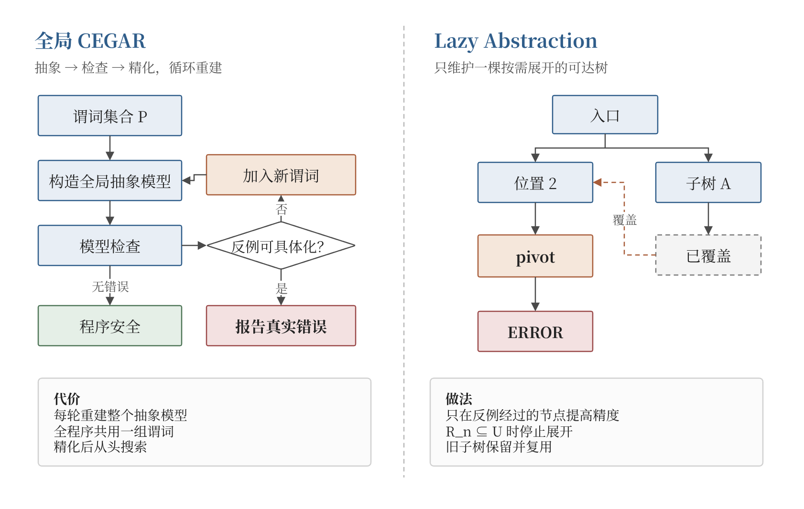
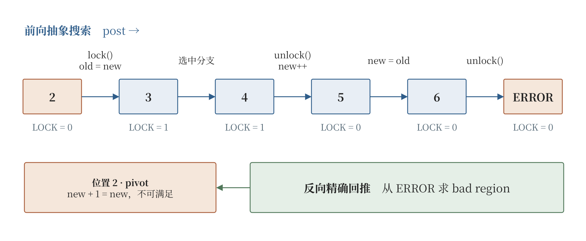

软件模型检查首先要得到一个足够小、又足够精确的有限图。程序里的整数、指针和循环让具体状态空间迅速膨胀，甚至无限；谓词抽象把状态压缩成有限谓词上的布尔组合，才让模型检查重新变得可行。抽象本身是可靠的：抽象模型没有错误，原程序就没有错误。但它也可能把一个本来不可达的错误路径保留下来，于是需要从虚假反例中补充谓词，再重新检查。

这就是反例驱动的抽象精化（CEGAR）的基本循环。Henzinger、Jhala、Majumdar 和 Sutre 在 POPL 2002 的 *Lazy Abstraction* 中关心的，不是再发明一种谓词抽象，而是改变这个循环的组织方式。[^paper] 标准 CEGAR 每轮都要构造一个全局抽象模型，精化后再从头检查；Lazy Abstraction 则从入口开始展开一棵抽象可达树，只在反例经过的节点上提高精度，并用覆盖关系复用已经检查过的子树。论文把这种做法概括为“按需构造、按需精化”（on-the-fly construction and refinement），并把它实现成面向 C 程序的 BLAST（Berkeley Lazy Abstraction Software verification Tool）。

下面先从全局 CEGAR 的工作方式和代价讲起，再进入论文的锁例子。锁例子说明虚假反例是怎样产生的；沿着反例回推，可以看到坏区域、pivot 和 `focus` 算子；后面讨论节点级的局部精度、覆盖与时间戳，最后给出算法、实验结果和终止性结论。

## 1. 背景：抽象、CEGAR 与全局重建

### 1.1 从程序到抽象状态

把 C 程序转成控制流自动机（CFA）之后，程序状态可以写成 $(l,s)$：$l$ 是控制位置，$s$ 是数据状态。安全性质通常表示成一个错误区域 $E$，验证目标是证明从初始区域 $I$ 出发，任何可达状态都不落在 $E$ 中。

具体数据状态可能有无穷多个。谓词抽象选择一个有限谓词集合 $\Gamma$，用这些谓词上的布尔公式 $\varphi$ 来描述一组具体状态：

$$
\llbracket \varphi\rrbracket
=\{s\mid s\models\varphi\}.
$$

例如只有一个谓词 $x<0$ 时，整数状态被分成满足和不满足两类；谓词越多，抽象状态能保留的区分就越多。

抽象状态不是单个具体状态，而是一个区域。抽象后继 $\widehat{\operatorname{post}}$ 对具体后继做上近似：

$$
\operatorname{post}_a(\llbracket\varphi\rrbracket)
\subseteq
\llbracket\widehat{\operatorname{post}}_a(\varphi,\Gamma)\rrbracket.
$$

如果抽象可达区域与 $E$ 不相交，原程序就是安全的；如果抽象搜索到达 $E$，只说明可能存在一条错误路径，还需要检查这条路径在具体程序中是否可行。[^predabs]

### 1.2 全局 CEGAR 的循环

标准 CEGAR 把抽象、检查和精化分成三个反复执行的步骤：

1. 选择一组谓词 $\Gamma$，构造全局抽象模型；
2. 在抽象模型上做模型检查；
3. 如果出现抽象反例，检查它能否具体化。能具体化就报告真实错误；不能，就从反例中提取新谓词，回到第 1 步。

这个循环在概念上很清晰，实际使用中却有三种结构性代价。第一，每轮精化都要重新构造整个抽象模型，并重新计算可达状态。第二，所有控制位置共用同一组谓词。某些位置可能只需要知道“锁是否持有”，另一些位置却需要知道两个计数变量之间的关系；全局谓词集只能整体变精确，不能只修改出问题的那一段。[^cegar] 第三，精化后从头检查意味着前一轮得到的覆盖关系、已经排除的子树和已经算过的抽象后继都很难继续使用。如果每次只改一条反例经过的路径，却要把整个程序重新分析一遍，大部分工作都浪费在重复计算上。

论文把这种重复概括为“从抽象到验证再到精化的循环太长”。同一时期，SLAM 等工具也在用 CEGAR 检查 C 程序的接口性质；BLAST 的区别主要在于把抽象模型做成按需展开的树，而不是每轮重建全局模型。

### 1.3 论文想改变什么

Lazy Abstraction 并不试图让抽象更粗；它让精度跟着搜索走。它维护一棵从初始区域展开的可达树，树中每个节点有自己的控制位置、数据区域和支撑谓词集合。搜索只在需要的时候展开节点；遇到虚假反例时，只在反例指出的位置提高精度；已经检查过的区域如果能覆盖新区域，就不再重复展开。

论文要回答的问题因此是：能否把抽象模型做成搜索树的一部分，只在需要的位置提高精度，并在精化后保留已经完成的工作。

两者的差别主要集中在以下几个方面。

| 维度 | 全局 CEGAR | Lazy Abstraction |
| :--- | :--- | :--- |
| 抽象模型 | 每轮重建一个全局模型 | 维护一棵按需展开的可达树 |
| 精度 | 所有位置共用一组谓词 | 每个节点有自己的支撑谓词 |
| 精化 | 加入谓词后重新检查整个模型 | 从 pivot 开始局部精化 |
| 复用 | 上一轮的可达结果大多丢弃 | 用覆盖关系复用旧子树 |
| 终止 | 取决于谓词集和抽象 | 需要额外的充分条件 |

论文的贡献大致有三部分：一是把抽象、检查和精化整合到同一棵可达树上的算法；二是面向 C 程序的符号实现 BLAST，包括从不可满足性证明中提取谓词的 `focus` 算子；三是终止性的充分条件，以及有限谓词抽象问题（`L-FINABS`）的不可判定性。



## 2. 锁例子：一条虚假的二次解锁路径

论文第 2 节用一个锁检查程序说明问题。程序进入函数时假定锁未持有；`lock()` 在锁已持有时进入 `ERROR`，`unlock()` 在锁未持有时进入 `ERROR`。下面只保留与第一条反例有关的循环，控制位置编号沿用论文：

```c title="论文 §2：位置 2–6 的锁循环" frame="code" mark={5-6,9-10}
do {
    /* 2 */ lock();
    /*   */ old = new;
    /* 3 */ if (nondet_bool()) {
        /* 4 */ unlock();
        /*   */ new++;
    }
    /* 5 */
} while (new != old);
/* 6 */ unlock();
```

`old` 和 `new` 按数学整数理解，`nondet_bool()` 表示两个分支都可以选择。若执行位置 4 的分支，当前轮先解锁，再执行 `new++`。由于本轮开头已经执行过 `old = new`，此时 `new != old`，循环必须继续。若跳过位置 4，锁仍然持有，`new = old`，循环退出后位置 6 的 `unlock()` 是合法的。

先只用 $\texttt{LOCK}=0$ 和 $\texttt{LOCK}=1$ 作为支撑谓词。走过位置 4 之后，抽象状态只记得“锁已经释放”，丢掉了 `new` 和 `old` 的关系。位置 5 的退出条件 $\texttt{new}=\texttt{old}$ 与“锁未持有”在抽象中仍然可以同时成立，于是搜索继续走到位置 6，再走向 `ERROR`。这条路径在具体程序中不可行，因为执行过位置 4 的那一轮不可能以 `new = old` 退出循环；但在只跟踪 `LOCK` 的抽象里，它看起来是可行的。[^initial]

这里的问题并不在于抽象不知道锁的状态，而在于它没有保留 `new` 与 `old` 之间的关系。要排除这条反例，需要补上一条等式谓词；剩下的问题是选择在哪个位置补，才能既排除反例，又不把整个程序重新精化一遍。



## 3. 反例为什么是假的：坏区域与 pivot

### 3.1 精确前驱

设 $R_i$ 是前向搜索在节点 $i$ 得到的抽象可达区域，$B_i$ 是从节点 $i$ 沿反例剩余边走到错误所需的坏区域。$B_i$ 用精确前驱逐边回推：

$$
\begin{aligned}
B_{\mathrm{err}} &= E,\\
B_i(s) &= \operatorname{pre}_{a_i}(B_{i+1})(s)\\
&= \exists s'\,\bigl(T_{a_i}(s,s')\land B_{i+1}(s')\bigr).
\end{aligned}
$$

错误位置本身没有额外的数据约束，所以 $B_{\mathrm{err}}=\top$（这里把控制位置单独记在表中）。对这个例子，回推结果如下：

| 位置 | 前向区域 $R_i$ | 反向坏区域 $B_i$ | $R_i\land B_i$ |
| :--- | :--- | :--- | :--- |
| 6，准备再次解锁 | $\texttt{LOCK}=0$ | $\texttt{LOCK}=0$ | 非空 |
| 5，检查循环条件 | $\texttt{LOCK}=0$ | $\texttt{LOCK}=0\land\texttt{new}=\texttt{old}$ | 非空 |
| 4，准备执行分支里的解锁 | $\texttt{LOCK}=1$ | $\texttt{LOCK}=1\land\texttt{new}+1=\texttt{old}$ | 非空 |
| 3，选择进入分支 | $\texttt{LOCK}=1$ | $\texttt{LOCK}=1\land\texttt{new}+1=\texttt{old}$ | 非空 |
| 2，准备获取锁并保存计数值 | $\texttt{LOCK}=0$ | $\texttt{LOCK}=0\land\texttt{new}+1=\texttt{new}$ | 空 |

位置 5 的坏区域已经合入了退出条件。回到位置 4，`new++` 把 `new = old` 变成 `new + 1 = old`，合法解锁又要求此时 `LOCK = 1`。位置 3 走的是非确定分支，数据条件保持不变。再回到位置 2，`old = new` 把等式右边的 `old` 换成 `new`，得到 `new + 1 = new`，矛盾。

### 3.2 pivot 是第一个空交集

从错误节点往根回溯，位置 3 仍然与坏区域相交，位置 2 第一次出现空交集。论文称这个节点为 **pivot node**（枢轴节点）。换一种说法，Algorithm 2 先找到最老的、与坏区域相交的祖先 $n_0$，再取它的父节点作为 pivot；在这个例子里 $n_0$ 是位置 3，父节点位置 2 就是 pivot。两种说法等价，后者更贴近论文的伪代码。

pivot 的意义在于：所有沿原前缀到达位置 2 的具体状态都落在 $R_2$ 中，而 $R_2$ 与 $B_2$ 不相交，所以没有任何具体状态能沿这条后缀走到错误。反例是假的，但错在位置 2 之后的那段路径。精化应该从这里开始，而不是把整棵树重新展开。

### 3.3 focus：从不可满足性证明中找谓词

论文第 5.3 节的 `focus` 算子负责把“这里需要更精确”变成一组具体的支撑谓词。它给变量加版本标记，保留赋值之间的等式，再从不可满足性证明中挑出起作用的原子谓词。

在锁例子里，分支结束后的 `new` 记为 $n_1$，本轮开始时的 `new` 记为 $n_0$，快照 `old` 记为 $o_1$。证明用到了

$$
o_1=n_0,\qquad n_1=n_0+1,\qquad n_1=o_1.
$$

最后一项来自退出条件。把这些等式中的版本标记去掉，就得到可以在前向搜索中跟踪的谓词 $\texttt{new}=\texttt{old}$。加入它之后，位置 2 的数据公式仍然是 $\texttt{LOCK}=0$，因为此时还没有执行 `old = new`；变化体现在从位置 2 计算出的后继上。

```diff lang="text" title="位置 5：执行了解锁分支之后"
- LOCK = 0
+ LOCK = 0 && new != old
```

同一个等式谓词既可以以肯定形式出现，也可以以否定形式出现。现在位置 5 的抽象后继会把退出边筛掉，回到位置 2 的边仍然可走。精化排除了一条虚假路径，但循环回到位置 2 后，搜索仍可能继续展开；覆盖关系就是用来终止这种重复的。

## 4. 局部精度：节点、覆盖与时间戳

### 4.1 一个节点记录区域和精度

节点的数据部分写成 $(\varphi,\Gamma)$。$\varphi$ 是用支撑谓词集合 $\Gamma$ 写成的布尔公式，表示当前允许哪些具体状态；$\Gamma$ 决定后续抽象转移还能保留哪些信息。控制位置也必须匹配，跨过程分析还要考虑调用栈。

这里需要区分“区域”和“精度”。$(\texttt{LOCK}=0,\Gamma)$ 与 $(\texttt{LOCK}=0,\Gamma\cup\{\texttt{new}=\texttt{old}\})$ 表示同一个具体状态集合，但后者多了一个观察维度。支撑谓词不是对当前状态的断言，它只是允许后续抽象转移观察这个谓词。等式要等程序执行 `old = new` 之后才会成为已知事实，所以位置 2 的区域不变，节点的精度却变了。

计算抽象后继时使用笛卡尔谓词抽象。对每个支撑谓词，分别检查后继是否必然满足它或它的否定；两边都推不出来，就省略这一项。这样每条边要检查的谓词个数随支撑集线性增长，代价是可能丢掉谓词之间的析取关系。[^cartesian]

### 4.2 覆盖是一个包含检查

精化之后，从循环体回到位置 2 的新叶子满足 $\texttt{LOCK}=0\land\texttt{new}\ne\texttt{old}$。位置 2 已经展开过，入口处的区域只要求 $\texttt{LOCK}=0$，包含这个新区域。因此可以停止展开这个叶子：它的具体后继已经在先前的展开范围内。

一般地，令 $U$ 为所有已标记、未被覆盖的节点的可达区域之并。被覆盖节点的区域已经包含在 $U$ 中，因此不必重复计入。当前区域 $R_n$ 若满足

$$
\llbracket R_n\rrbracket\subseteq\llbracket U\rrbracket,
$$

就可以把节点 $n$ 标记为 **covered**。单个祖先包含新叶子是最常见的情况，Algorithm 2 也允许用多个区域的并，甚至用另一棵子树提供覆盖。检查比较的是具体状态集合，两个节点的支撑谓词集合可以不同；这一点是局部精度能成立的关键。

锁例子还有一条从位置 7 开始的可选分支。每轮先清零 `got_lock`，若获取了锁就递增它，随后只在 `got_lock` 非零时解锁。如果忘记这个变量，抽象搜索可能在跳过加锁后仍进入解锁分支。跟踪 $\texttt{got\_lock}=0$ 就能区分这两条路径。这棵子树也会流向位置 2，那些叶子满足 $\texttt{LOCK}=0$，可以由先前的位置 2 节点覆盖。


### 4.3 覆盖失效后要重新检查

覆盖能省掉整棵子树，前提是提供覆盖的区域仍然有效。精化可能删除旧节点，也可能把节点区域缩小；原来成立的包含关系，此时需要重新检查。

覆盖关系用**标记时间戳**维护。每个已标记节点带一个时间戳，记录它最近一次被标记的时间。精化 pivot 时，把在它之后才被标记为已覆盖的叶子撤销标记，让这些叶子回到待处理状态。深度优先展开时，受影响的检查可以限制在 pivot 的子树内。

Algorithm 2 还留了一个 `keep subtree` 选择。精化时既可以保留 pivot 的子树，重算从 pivot 到当前节点的反例路径；也可以删除 pivot 的后代，从 pivot 重新展开。保留子树能复用更多计算，但论文 §4.2 的例子说明，保留过粗的旧节点有时会让同一轮精化和搜索不断重演。终止性定理要求 `keep subtree` 总是返回 false，也就是精化时删除后代。

## 5. 把算法连起来

朴素的全局 CEGAR 用一组谓词构造抽象模型，模型出现虚假反例后扩大谓词集，再构造和检查新模型。Lazy Abstraction 把抽象后继的计算推迟到节点展开时，把新增谓词放到反例指出的位置。论文先在带标签的转移系统和抽象结构上定义算法，C 程序只是其中一个实例；下面用锁例子和 C 程序的语言描述主循环，具体的 BDD、CFA 数据结构不参与正确性论证。

主循环可以写成下面的形式：

```text title="LazyAbstraction：主循环" frame="code" mark={4,8}
while 仍有未处理节点:
    取出一个未处理节点 n
    if R_n 与错误区域 E 相交:
        找到最老的、满足 R_n0 与 B_n0 相交的祖先 n0
        if n0 是根: 返回真实错误路径
        pivot = n0 的父节点
        用 focus 从 pivot 提高局部精度
        保留并重标 pivot 到 n 的路径，或删除 pivot 的后代
        撤销 pivot 之后作出的覆盖标记，重新处理相关叶子
    else if R_n 被 U 覆盖:
        标记 n 为已覆盖
    else:
        展开抽象后继，把新节点加入树
返回所有已标记、未被覆盖的节点区域之并 U
```

算法返回安全区域的依据是：令 $U$ 为它返回的区域并集。每个展开过的节点都计算过对具体后继的过近似；被覆盖的后继已经包含在 $U$ 中；覆盖失效时，相关叶子会重新参与搜索。这样，搜索结束时 $U$ 包含初态、对具体转移闭合，并与错误区域不相交。论文 Theorem 2 给出了两种终止结果的正确性：返回的错误路径在具体模型中可行，或者返回一个避开错误区域的可达状态过近似。

如果返回错误路径，说明根节点仍与坏区域相交；坏区域是沿该路径的精确前驱，因此初始区域中的某个具体状态确实能走完整条路径。这一半的论证依赖精确的 `pre`，而前向搜索使用的 `post` 可以是上近似。

<details>
<summary>用归纳不变式重写这个证明</summary>

将初始区域写作 $I$，错误区域写作 $E$，整个系统的一步后继写作 $\operatorname{post}$。安全结果给出的区域 $U$ 满足

$$
I\subseteq U,\qquad
\operatorname{post}(U)\subseteq U,\qquad
U\cap E=\varnothing.
$$

第一项给出归纳起点，第二项把任意有限执行的下一步留在 $U$ 内。第三项随即排除所有可达的错误状态。在 C 实例里，可以按控制位置阅读这个区域的析取项。

</details>


## 6. BLAST 的实验

BLAST 用 C-Breeze 生成 CFA，用 BDD（二元决策图）表示谓词上的布尔公式。Simplify 负责蕴含和空性检查，Vampyre 从不可满足性证明中为 `focus` 提供谓词。定理证明器的查询结果会被缓存；对未受当前语句影响的谓词，也可以省去一部分查询。论文中的实现用显式栈处理过程调用，不支持递归，并简化了指针算术。

下表摘录论文 §6 的实验数据。活跃谓词数按树中单个节点的峰值计，运行时间不含解析：

| 样例 | 代码行数 | 谓词总数 | 峰值活跃谓词数 | 定理证明器查询（缓存命中 / 总数） | 用时（秒） |
| :--- | ---: | ---: | ---: | ---: | ---: |
| `driver.c` | 95 | 3 | 3 | 165 / 260 | 0.08 |
| `funlock.c` | 40 | 4 | 3 | 182 / 340 | 0.14 |
| `read.c` | 370 | 28 | 18 | 2,862 / 5,643 | 4.42 |
| `floppy.c` | 6,473 | 5 | 5 | 3,759 / 4,137 | 2.05 |
| `qpmouse.c` | 400 | 3 | 3 | 2,925 / 3,117 | 0.74 |
| `ll_rw_block.c` | 1,281 | 9 | 7 | 9,483 / 10,143 | 5.82 |

`funlock.c` 就是前面的锁示例。初始的两个锁谓词，加上两棵子树分别发现的等式，总共是四个；单个节点最多同时使用三个。`read.c` 的两条分支需要不同的谓词，局部使用数与总数之间的差距更明显。`floppy.c` 的谓词总数和峰值活跃数相同，这组数据主要体现了查询缓存的作用，而不是局部精化。

这些数字能说明局部精度在一些程序上确实减少了同时活跃的谓词，但不能直接量化相对全局 CEGAR 的加速比。论文没有给出逐项的全局重建对照时间，实验平台也是 800 MHz Pentium III、256 MB 内存，时间不含解析。[^timing] 驱动实验还带有一个额外假设：性质由人工插桩编码成错误位置，内核模型负责调用驱动；谓词语言之外的构造按未解释函数处理。论文同时说明，当时的实现不支持递归，指针算术也被简化。

## 7. 什么时候能保证停下来

正确性定理讨论的是已经终止的执行。§7.1 给出一组终止的充分条件：错误状态被建模成没有出边；精化时总是丢弃 pivot 的后代；`focus` 提高精度后，沿原后缀重新计算抽象后继也能排除该反例。在这些前提下，还需要两个条件：

1. **系统具有有限迹等价。** 两个状态如果能执行相同的有限标签序列，就属于同一个迹等价类。要求这样的等价类只有有限多个，具体状态仍然可以有无限多个。
2. **区域满足升链条件。** 按具体状态集合的包含关系，区域之间没有无限严格上升链 $\llbracket R_0\rrbracket\subsetneq\llbracket R_1\rrbracket\subsetneq\cdots$。固定有限谓词集的布尔组合满足这个条件。

证明利用有限迹等价限制同一个树节点被反复精化的次数；如果搜索一直继续，就会产生一条严格上升的区域链，与第二个条件矛盾。

§7.2 讨论有限谓词抽象问题的可判定性。给定两计数器机 $M$、初始状态 $m_0$ 和目标状态 $m_f$，`L-FINABS` 回答 Yes 当且仅当 $m_f$ 从 $m_0$ 可达，或者存在有限谓词集 $\Phi$，使得在商系统 $M/{\equiv_\Phi}$ 中 $[m_f]$ 不可达。论文从两计数器机的停机问题归约，证明即使是 Presburger 算术（整数加法与比较）约束的版本 `Presburger-FINABS`，也是 $\Sigma_1^0$-完全的（算术层级第一层的完备问题），因此不可判定。[^finabs]

这个结论有一个直接的后果：Lazy Abstraction 一般只是一个半算法。它可能在安全程序上不终止；有限迹等价和升链条件只是保证终止的常用充分条件，不是算法正确性的必要条件。

## 8. 回到锁例子

$\texttt{new}=\texttt{old}$ 最有用的地方，是从位置 2 到循环条件的那段搜索。它在 `old = new` 之后为真，在执行 `new++` 的分支之后为假，恰好能区分“还要继续循环”和“持锁退出”。另一边的子树只需要知道 `got_lock` 是否为零，流回位置 2 时又能复用已有结果。这个例子把论文的设计动机落到了一个具体选择上：让反例决定在哪里增加精度，让覆盖决定哪些后继已经检查过。

把这篇论文放回当时的工具背景，它的主要贡献在组织方式：全局 CEGAR 把“证明安全”看成一组全局谓词上的抽象模型；Lazy Abstraction 把它看成一棵带有局部精度的可达树。前者每轮重建模型，后者只在反例经过的路径上修改节点。BLAST 的实验说明这种组织方式可以处理真实的设备驱动代码，但实现仍受限于当时的 C 前端、过程调用和指针模型。

站内的 [[PaperHub/Hyperproperty_Abstraction_Refinement|超性质验证中的对齐与抽象精化]] 也讨论了怎样从反例中补充谓词。那篇文章里的自组合还需要选择多条执行的调度，可以沿着“反例是什么形状、精化改动哪个对象”这两个问题接着读。两者关心的验证问题不同，但都把“反例”当成定位精度缺口的线索，而不是单纯的失败信息。

[^paper]: Thomas A. Henzinger、Ranjit Jhala、Rupak Majumdar、Grégoire Sutre，*Lazy Abstraction*，POPL 2002，58–70。[ACM DOI](https://doi.org/10.1145/503272.503279) · [作者主页上的论文条目](https://cseweb.ucsd.edu/~rjhala/papers/lazy_abstraction.html)。

[^initial]: 论文 §2 也指出，可以从空谓词集开始，让虚假反例驱动这些锁谓词的发现。这里从 `LOCK` 谓词起步，只是为了缩短演示。

[^predabs]: 谓词抽象的代表性工作包括 Graf 与 Saïdi 的 *Construction of Abstract State Graphs with PVS*（CAV 1997），以及 Ball、Podelski 与 Rajamani 的 *Boolean and Cartesian Abstraction for Model Checking C Programs*（TACAS 2001）。

[^cegar]: Clarke、Grumberg、Jha、Lu 与 Veith 在 *Counterexample-Guided Abstraction Refinement*（CAV 2000）中系统化了这一循环；Ball 与 Rajamani 在 *Automatically Validating Temporal Safety Properties of Interfaces*（SPIN 2001）中把它用于 C 程序的接口性质检查。

[^cartesian]: 例如精确后继只保证 $p\lor q$，且 $p$、$q$ 都可能单独为假。逐一检查 $p$、$\neg p$、$q$、$\neg q$，就可能一个文字也保留不下来。论文 §3.2 也讨论了计算更精确的布尔抽象。

[^timing]: 论文实验平台是 800 MHz Pentium III，配备 256 MB 内存。表里的时间来自同一版本的 BLAST，论文未给出逐项的全局重建对照时间。

[^finabs]: 论文形式化的 `L-FINABS` 判定对两种情况都回答 Yes：错误确实可达，或存在一个有限谓词商系统能证明错误不可达。Theorem 4 证明 `Presburger-FINABS` 是 $\Sigma_1^0$-完全的，因此不可判定。
