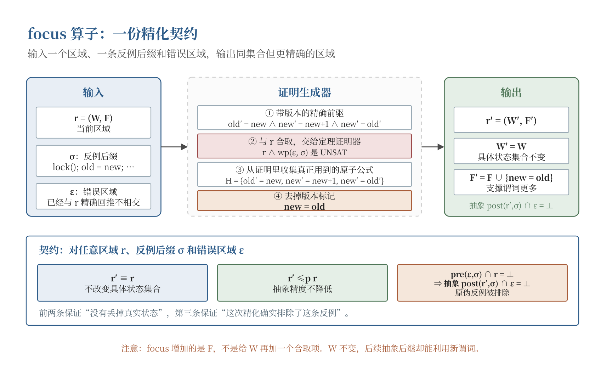
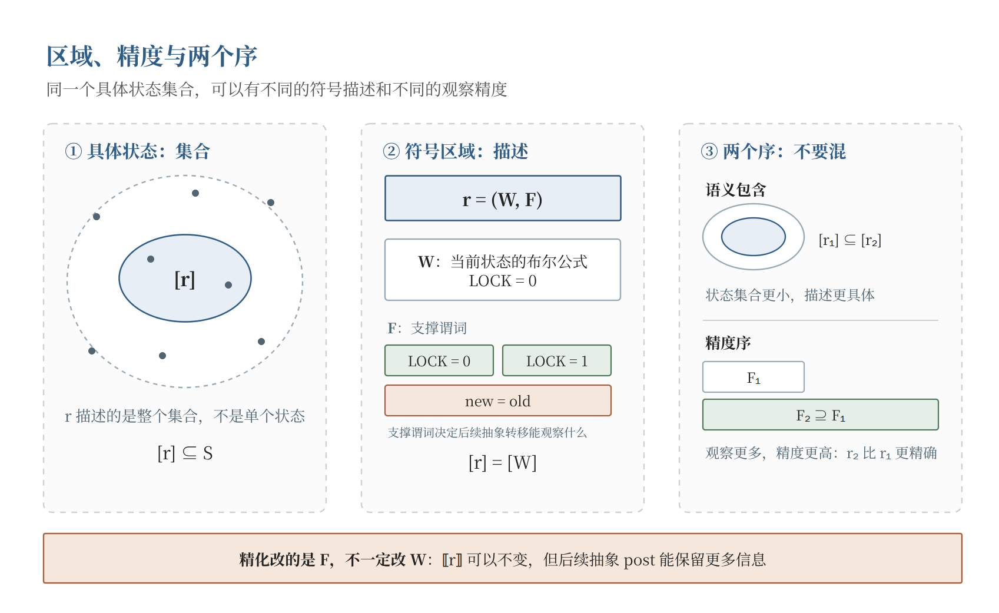
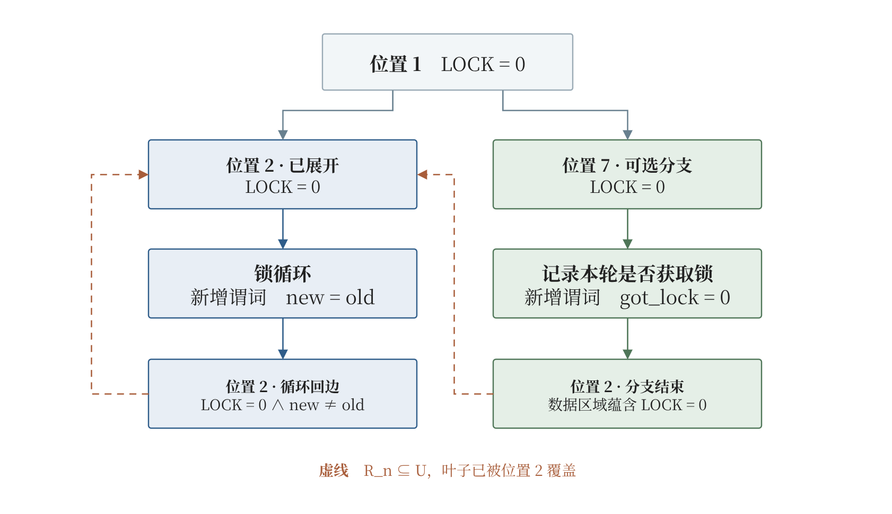
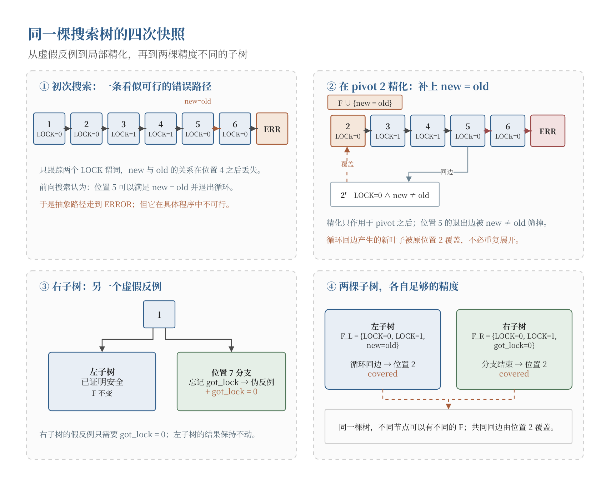
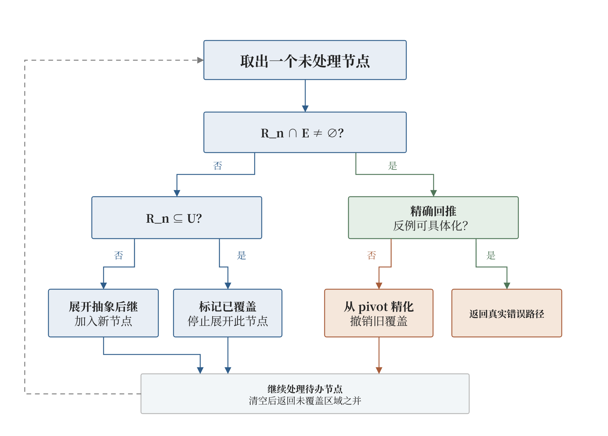
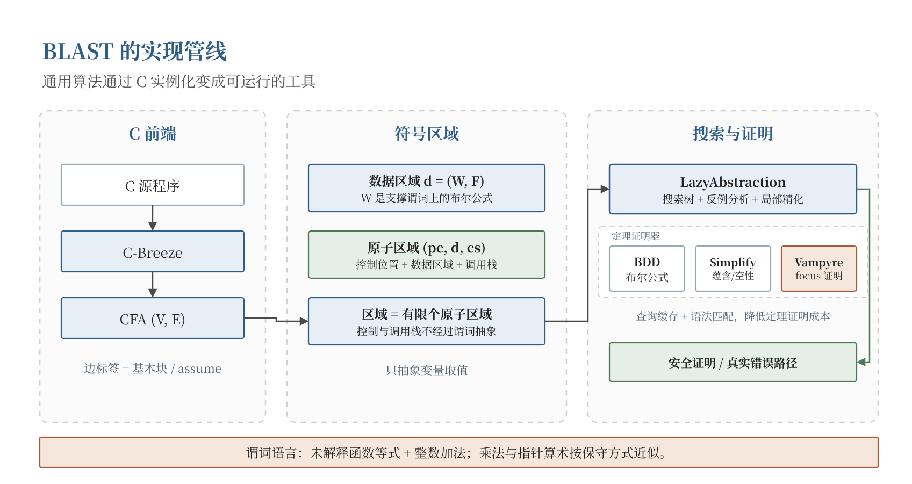
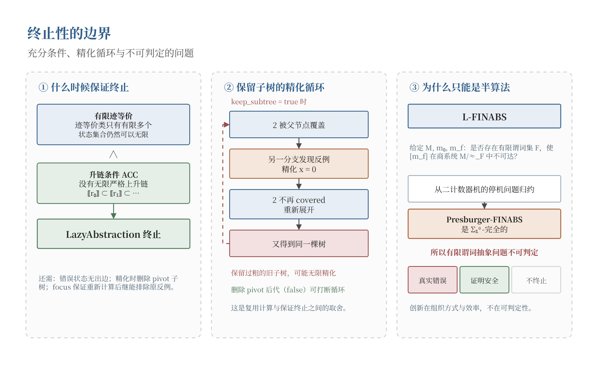

软件模型检查首先要得到一个足够小、又足够精确的有限图。程序里的整数、指针和循环让具体状态空间迅速膨胀，甚至无限；谓词抽象把状态压缩成有限谓词上的布尔组合，才让模型检查重新变得可行。抽象本身是可靠的：抽象模型没有错误，原程序就没有错误。但它也可能把一个本来不可达的错误路径保留下来，于是需要从虚假反例中补充谓词，再重新检查。

这就是反例驱动的抽象精化（CEGAR）的基本循环。Henzinger、Jhala、Majumdar 和 Sutre 在 POPL 2002 的 *Lazy Abstraction* 中关心的，不是再发明一种谓词抽象，而是改变这个循环的组织方式。[^paper] 标准 CEGAR 每轮都要构造一个全局抽象模型，精化后再从头检查；Lazy Abstraction 则从入口开始展开一棵抽象可达树，只在反例经过的节点上提高精度，并用覆盖关系复用已经检查过的子树。论文把这种做法概括为“按需构造、按需精化”（on-the-fly construction and refinement），并把它实现成面向 C 程序的 BLAST（Berkeley Lazy Abstraction Software verification Tool）。

下面先从全局 CEGAR 的工作方式和代价讲起，再进入论文的锁例子。锁例子说明虚假反例是怎样产生的；沿着反例回推，可以看到坏区域、pivot 和 `focus` 算子。第 4 节把区域结构和两个序补全，随后讨论节点级精度、覆盖与时间戳，最后给出算法、BLAST 的实现、实验结果和终止性边界。

## 1. 背景：抽象、CEGAR 与全局重建

### 1.1 从程序到抽象状态

把 C 程序转成控制流自动机（CFA）之后，程序状态可以写成 $(l,s)$：$l$ 是控制位置，$s$ 是数据状态。安全性质通常表示成一个错误区域 $E$，验证目标是证明从初始区域 $I$ 出发，任何可达状态都不落在 $E$ 中。

具体数据状态可能有无穷多个。谓词抽象选择一个有限谓词集合 $\Gamma$，用这些谓词上的布尔公式 $\varphi$ 来描述一组具体状态：

$$
\llbracket \varphi\rrbracket
=\{s\mid s\models\varphi\}.
$$

例如只有一个谓词 $x<0$ 时，整数状态被分成满足和不满足两类；谓词越多，抽象状态能保留的区分就越多。

抽象状态不是单个具体状态，而是一个区域。抽象后继 $\widehat{\operatorname{post}}$ 对具体后继做上近似：

$$
\operatorname{post}_a(\llbracket\varphi\rrbracket)
\subseteq
\llbracket\widehat{\operatorname{post}}_a(\varphi,\Gamma)\rrbracket.
$$

如果抽象可达区域与 $E$ 不相交，原程序就是安全的；如果抽象搜索到达 $E$，只说明可能存在一条错误路径，还需要检查这条路径在具体程序中是否可行。[^predabs]

### 1.2 全局 CEGAR 的循环

标准 CEGAR 把抽象、检查和精化分成三个反复执行的步骤：

1. 选择一组谓词 $\Gamma$，构造全局抽象模型；
2. 在抽象模型上做模型检查；
3. 如果出现抽象反例，检查它能否具体化。能具体化就报告真实错误；不能，就从反例中提取新谓词，回到第 1 步。

这个循环在概念上很清晰，实际使用中却有三种结构性代价。第一，每轮精化都要重新构造整个抽象模型，并重新计算可达状态。第二，所有控制位置共用同一组谓词。某些位置可能只需要知道“锁是否持有”，另一些位置却需要知道两个计数变量之间的关系；全局谓词集只能整体变精确，不能只修改出问题的那一段。[^cegar] 第三，精化后从头检查意味着前一轮得到的覆盖关系、已经排除的子树和已经算过的抽象后继都很难继续使用。如果每次只改一条反例经过的路径，却要把整个程序重新分析一遍，大部分工作都浪费在重复计算上。

论文把这种重复概括为“从抽象到验证再到精化的循环太长”。同一时期，SLAM 等工具也在用 CEGAR 检查 C 程序的接口性质；BLAST 的区别主要在于把抽象模型做成按需展开的树，而不是每轮重建全局模型。

### 1.3 论文想改变什么

Lazy Abstraction 并不试图让抽象更粗；它让精度跟着搜索走。它维护一棵从初始区域展开的可达树，树中每个节点有自己的控制位置、数据区域和支撑谓词集合。搜索只在需要的时候展开节点；遇到虚假反例时，只在反例指出的位置提高精度；已经检查过的区域如果能覆盖新区域，就不再重复展开。

论文要回答的问题因此是：能否把抽象模型做成搜索树的一部分，只在需要的位置提高精度，并在精化后保留已经完成的工作。

两者的差别主要集中在以下几个方面。

| 维度 | 全局 CEGAR | Lazy Abstraction |
| :--- | :--- | :--- |
| 抽象模型 | 每轮重建一个全局模型 | 维护一棵按需展开的可达树 |
| 精度 | 所有位置共用一组谓词 | 每个节点有自己的支撑谓词 |
| 精化 | 加入谓词后重新检查整个模型 | 从 pivot 开始局部精化 |
| 复用 | 上一轮的可达结果大多丢弃 | 用覆盖关系复用旧子树 |
| 终止 | 取决于谓词集和抽象 | 需要额外的充分条件 |

论文的贡献大致有三部分：一是把抽象、检查和精化整合到同一棵可达树上的算法；二是面向 C 程序的符号实现 BLAST，包括从不可满足性证明中提取谓词的 `focus` 算子；三是终止性的充分条件，以及有限谓词抽象问题（`L-FINABS`）的不可判定性。


## 2. 锁例子：一条虚假的二次解锁路径

论文第 2 节用一个锁检查程序说明问题。程序进入函数时假定锁未持有；`lock()` 在锁已持有时进入 `ERROR`，`unlock()` 在锁未持有时进入 `ERROR`。下面只保留与第一条反例有关的循环，控制位置编号沿用论文：

```c title="论文 §2：位置 2–6 的锁循环" frame="code" mark={5-6,9-10}
do {
    /* 2 */ lock();
    /*   */ old = new;
    /* 3 */ if (nondet_bool()) {
        /* 4 */ unlock();
        /*   */ new++;
    }
    /* 5 */
} while (new != old);
/* 6 */ unlock();
```

`old` 和 `new` 按数学整数理解，`nondet_bool()` 表示两个分支都可以选择。若执行位置 4 的分支，当前轮先解锁，再执行 `new++`。由于本轮开头已经执行过 `old = new`，此时 `new != old`，循环必须继续。若跳过位置 4，锁仍然持有，`new = old`，循环退出后位置 6 的 `unlock()` 是合法的。

先只用 $\texttt{LOCK}=0$ 和 $\texttt{LOCK}=1$ 作为支撑谓词。走过位置 4 之后，抽象状态只记得“锁已经释放”，丢掉了 `new` 和 `old` 的关系。位置 5 的退出条件 $\texttt{new}=\texttt{old}$ 与“锁未持有”在抽象中仍然可以同时成立，于是搜索继续走到位置 6，再走向 `ERROR`。这条路径在具体程序中不可行，因为执行过位置 4 的那一轮不可能以 `new = old` 退出循环；但在只跟踪 `LOCK` 的抽象里，它看起来是可行的。[^initial]

这里的问题并不在于抽象不知道锁的状态，而在于它没有保留 `new` 与 `old` 之间的关系。要排除这条反例，需要补上一条等式谓词；剩下的问题是选择在哪个位置补，才能既排除反例，又不把整个程序重新精化一遍。


## 3. 反例为什么是假的：坏区域与 pivot

### 3.1 精确前驱

设 $R_i$ 是前向搜索在节点 $i$ 得到的抽象可达区域，$B_i$ 是从节点 $i$ 沿反例剩余边走到错误所需的坏区域。$B_i$ 用精确前驱逐边回推：

$$
\begin{aligned}
B_{\mathrm{err}} &= E,\\
B_i(s) &= \operatorname{pre}_{a_i}(B_{i+1})(s)\\
&= \exists s'\,\bigl(T_{a_i}(s,s')\land B_{i+1}(s')\bigr).
\end{aligned}
$$

错误位置本身没有额外的数据约束，所以 $B_{\mathrm{err}}=\top$（这里把控制位置单独记在表中）。对这个例子，回推结果如下：

| 位置 | 前向区域 $R_i$ | 反向坏区域 $B_i$ | $R_i\land B_i$ |
| :--- | :--- | :--- | :--- |
| 6，准备再次解锁 | $\texttt{LOCK}=0$ | $\texttt{LOCK}=0$ | 非空 |
| 5，检查循环条件 | $\texttt{LOCK}=0$ | $\texttt{LOCK}=0\land\texttt{new}=\texttt{old}$ | 非空 |
| 4，准备执行分支里的解锁 | $\texttt{LOCK}=1$ | $\texttt{LOCK}=1\land\texttt{new}+1=\texttt{old}$ | 非空 |
| 3，选择进入分支 | $\texttt{LOCK}=1$ | $\texttt{LOCK}=1\land\texttt{new}+1=\texttt{old}$ | 非空 |
| 2，准备获取锁并保存计数值 | $\texttt{LOCK}=0$ | $\texttt{LOCK}=0\land\texttt{new}+1=\texttt{new}$ | 空 |

位置 5 的坏区域已经合入了退出条件。回到位置 4，`new++` 把 `new = old` 变成 `new + 1 = old`，合法解锁又要求此时 `LOCK = 1`。位置 3 走的是非确定分支，数据条件保持不变。再回到位置 2，`old = new` 把等式右边的 `old` 换成 `new`，得到 `new + 1 = new`，矛盾。

这里有一个实现细节值得说明。论文并不是直接在语法上做 $Q[e/x]$ 的替换，而是为被赋值的变量引入一个新版本，例如用 `new'` 表示 `new++` 之后的值，并保留

$$
old' = new,\qquad new' = new+1,\qquad new' = old'
$$

这样的等式。这样，每条赋值关系都留在公式里，定理证明器才能追踪它到底用了哪条等式。最后把带撇号的版本去掉，`new = old` 就浮现为一条有用的支撑谓词。

### 3.2 pivot 是第一个空交集

从错误节点往根回溯，位置 3 仍然与坏区域相交，位置 2 第一次出现空交集。论文称这个节点为 **pivot node**（枢轴节点）。换一种说法，Algorithm 2 先找到最老的、与坏区域相交的祖先 $n_0$，再取它的父节点作为 pivot；在这个例子里 $n_0$ 是位置 3，父节点位置 2 就是 pivot。两种说法等价，后者更贴近论文的伪代码。

把这句话写成公式会更清楚。设当前反例路径是 $\sigma$，当前节点是 $n$。对路径上的祖先 $n_r$，记 $\sigma_r$ 为从 $n_r$ 到 $n$ 的标签序列，于是它的坏区域是 $B(n_r)=\operatorname{pre}(\varepsilon,\sigma_r)$。算法沿着路径从 $n$ 向根回溯，找最老的祖先 $n_r$，使得

$$
\operatorname{pre}(\varepsilon,\sigma_r)\cap R(n_r)\neq\bot .
$$

如果 $n_r$ 就是根，说明初始区域中存在一个具体状态能沿整条路径走到错误，反例是真实的。否则取 $n_r$ 的父节点 $n_{rr}$ 作为 pivot。此时有

$$
R(n_{rr})\cap B(n_{rr})=\bot,\qquad
R(n_r)\cap B(n_r)\neq\bot .
$$

所以 pivot 正好是“坏区域与可达区域的交集从空变为非空”的边界。它之后的那段路径是最小不可行后缀；它之前的前缀仍然可能到达 pivot，因此只需要从 pivot 往后提高精度。这里容易搞反：pivot 不是当前节点，也不是反例里第一个看起来不可行的节点，而是最老相交祖先的父节点。

pivot 的意义在于：所有沿原前缀到达位置 2 的具体状态都落在 $R_2$ 中，而 $R_2$ 与 $B_2$ 不相交，所以没有任何具体状态能沿这条后缀走到错误。反例是假的，但错在位置 2 之后的那段路径。精化应该从这里开始，而不是把整棵树重新展开。

### 3.3 focus：从不可满足性证明中找谓词

论文第 5.3 节的 `focus` 算子负责把“这里需要更精确”变成一组具体的支撑谓词。从接口上看，它是一个函数

$$
\Phi:R\times\Sigma^{*}\times R\to R,
$$

输入当前区域 $r$、需要排除的反例后缀 $\sigma$ 和错误区域 $\varepsilon$，输出一个精化后的区域 $r'=\Phi(r,\sigma,\varepsilon)$。这个函数必须满足三条契约：

$$
\Phi(r,\sigma,\varepsilon)\equiv r,
\qquad
\Phi(r,\sigma,\varepsilon)\sqsubseteq r,
$$

以及，当 $\operatorname{pre}(\varepsilon,\sigma)\cap r=\bot$ 时，

$$
\widehat{\operatorname{post}}\bigl(\Phi(r,\sigma,\varepsilon),\sigma\bigr)
\cap\varepsilon=\bot .
$$

第一条说新区域和旧区域表示同一个具体状态集合；第二条说新区域的抽象精度不低于旧区域；第三条说如果原反例在具体程序中确实不可行，那么在新的抽象精度下重新计算后继，也必须把这条反例排除掉。前两条保证“没有丢掉真实状态”，第三条保证“这次精化确实解决了这条反例”。

第三条不是算法正确性的必要条件，但它是后面终止性定理要用的条件：每次精化都要让当前反例真正消失，而不是只把区域改小一点、下次再遇到同一个问题。

在锁例子里，`focus` 先对整条反例后缀做带显式替换的弱前置条件。相关等式包括

$$
old'=new,\qquad
new'=new+1,\qquad
new'=old',
$$

如果把分支结束后的 `new` 记为 $n_1$、本轮开始时的 `new` 记为 $n_0$、快照 `old` 记为 $o_1$，那么这三条就是 $o_1=n_0$、$n_1=n_0+1$、$n_1=o_1$。其中 `new' = old'` 来自循环退出条件，`new' = new+1` 来自分支里的自增，`old' = new` 来自本轮开头的快照。此外还有解锁操作带来的 `LOCK' = 0`。把这些等式和当前区域 $r=(\texttt{LOCK}=0,\{\texttt{LOCK}=0,\texttt{LOCK}=1\})$ 合取，交给具有证明生成能力的定理证明器，得到的结论是不可满足。证明过程中真正用到的原子公式是 `old' = new`、`new' = new+1` 和 `new' = old'`；把版本标记去掉，`new = old` 就是那条有用的支撑谓词。于是

$$
r'=\bigl(\texttt{LOCK}=0,\ \{\texttt{LOCK}=0,\texttt{LOCK}=1,\texttt{new}=\texttt{old}\}\bigr).
$$

注意这里 $W$ 仍然是 `LOCK = 0`，变的是 $F$。位置 2 还没有执行 `old = new`，所以当前状态集合不需要改变；但新的支撑谓词让从位置 2 计算后继时能够保留 `new` 与 `old` 的关系。这正是“局部精化”能成立的关键。

:::important[focus 增加的是 F，不是给 W 再加一个合取项]
位置 2 的区域仍然是 `LOCK = 0`。`new = old` 不是对当前位置的断言，而是允许后续抽象转移观察这个谓词。把这一点和“加一个条件让区域变小”区分开，后面的精度序和覆盖判断才不会混。
:::



```diff lang="text" title="位置 5：执行了解锁分支之后"
- LOCK = 0
+ LOCK = 0 && new != old
```

同一个等式谓词既可以以肯定形式出现，也可以以否定形式出现。现在位置 5 的抽象后继会把退出边筛掉，回到位置 2 的边仍然可走。精化排除了一条虚假路径，但循环回到位置 2 后，搜索仍可能继续展开；覆盖关系就是用来终止这种重复的。

从树的角度看，新的支撑谓词只加到 pivot 及其后续路径上；pivot 之前的节点仍然使用原来的 $F$。这就是“局部”的含义：不是把整个程序的谓词集合换掉，而是只修改反例指出的那段搜索。

## 4. 局部精度：节点、覆盖与时间戳

### 4.1 一个节点记录区域和精度

节点的数据部分写成 $(\varphi,\Gamma)$。$\varphi$ 是用支撑谓词集合 $\Gamma$ 写成的布尔公式，表示当前允许哪些具体状态；$\Gamma$ 决定后续抽象转移还能保留哪些信息。控制位置也必须匹配，跨过程分析还要考虑调用栈。

这里需要区分“区域”和“精度”。$(\texttt{LOCK}=0,\Gamma)$ 与 $(\texttt{LOCK}=0,\Gamma\cup\{\texttt{new}=\texttt{old}\})$ 表示同一个具体状态集合，但后者多了一个观察维度。支撑谓词不是对当前状态的断言，它只是允许后续抽象转移观察这个谓词。等式要等程序执行 `old = new` 之后才会成为已知事实，所以位置 2 的区域不变，节点的精度却变了。

为了把这件事说清楚，先把“区域”写成定义。一个带标签转移系统是 $\mathcal S=(S,\Sigma,\longrightarrow)$，其中 $S$ 是状态集合，$\Sigma$ 是标签集合，$\longrightarrow\subseteq S\times\Sigma\times S$ 是转移关系。一个符号区域结构是

$$
\mathcal R=(R,\bot,\sqcup,\sqcap,\operatorname{pre},\operatorname{post},\llbracket\cdot\rrbracket),
$$

其中 $\llbracket r\rrbracket\subseteq S$ 是区域 $r$ 对应的具体状态集合，并且

$$
\llbracket\bot\rrbracket=\varnothing,\qquad
\llbracket r\sqcup r'\rrbracket=\llbracket r\rrbracket\cup\llbracket r'\rrbracket,\qquad
\llbracket r\sqcap r'\rrbracket=\llbracket r\rrbracket\cap\llbracket r'\rrbracket.
$$

精确前驱和后继分别是

$$
\begin{aligned}
\operatorname{pre}(r,l)
&=\{s\mid\exists s'.\,s\xrightarrow{l}s'\land s'\in\llbracket r\rrbracket\},\\
\operatorname{post}(r,l)
&=\{s'\mid\exists s.\,s\in\llbracket r\rrbracket\land s\xrightarrow{l}s'\}.
\end{aligned}
$$

这组定义只说明“区域代表哪个状态集合”，还没有说明“这个区域是用多精确的抽象得到的”。后者由抽象结构

$$
\mathcal A=(\mathcal R,\widehat{\operatorname{post}},\widehat{\operatorname{pre}},\sqsubseteq)
$$

给出。精度预序 $\sqsubseteq$ 比较两个区域的观察能力；抽象后继要求覆盖真实后继：

$$
\operatorname{post}(r,l)\preceq\widehat{\operatorname{post}}(r,l),
\qquad
\operatorname{pre}(r,l)\preceq\widehat{\operatorname{pre}}(r,l),
$$

其中 $r\preceq r'$ 表示 $\llbracket r\rrbracket\subseteq\llbracket r'\rrbracket$。此外还要求这些操作对精度序单调：更精确的输入不会产生更粗的输出。

在谓词抽象里，区域具体写成

$$
r=(W,F),
$$

$F$ 是有限支撑谓词集合，$W$ 是 $F$ 上的布尔公式，语义是

$$
\llbracket(W,F)\rrbracket=\llbracket W\rrbracket.
$$

于是有两个不同的序：

| 序 | 比较什么 | 方向 |
| :--- | :--- | :--- |
| 语义包含 $r\preceq r'$ | 具体状态集合 | $\llbracket r\rrbracket\subseteq\llbracket r'\rrbracket$，左侧更小、更具体 |
| 精度 $r\sqsubseteq r'$ | 支撑谓词集合 | $(W,F)\sqsubseteq(W',F')$ 当且仅当 $F\supseteq F'$，左侧观察更多 |

这两个序不能混。覆盖检查问的是“这个区域的状态集合是否已经被别处包含”，所以用 $\preceq$；精化问的是“这个区域是否还能观察更多谓词”，所以用 $\sqsubseteq$。在谓词抽象中，增加支撑谓词可以让 $F$ 变大、让 $r$ 在精度序下更靠前，但 $W$ 和 $\llbracket r\rrbracket$ 可以完全不变。



现在来看抽象后继到底怎么算。固定当前支撑谓词集合 $F$，把 $W$ 写成规范化的析取范式。对每个析取项 $g$ 和每个支撑谓词 $p\in F$，分别检查

$$
g\Rightarrow \operatorname{wp}(p,l),
\qquad
g\Rightarrow \operatorname{wp}(\neg p,l).
$$

如果前者成立，就在新的析取项里放 $p$；如果后者成立，就放 $\neg p$；两者都推不出来，就省略这一项。把所有析取项并起来，得到 $W'$，并返回

$$
\widehat{\operatorname{post}}((W,F),l)=(W',F).
$$

这就是笛卡尔谓词抽象。[^cartesian] 它的计算量随支撑谓词个数线性增长，但可能丢掉谓词之间的析取关系；它有一个非常重要的性质：**抽象后继不会增加支撑谓词**。精确的 `pre` 和 `post` 可能引入当前 $F$ 之外的谓词，抽象 `post` 则固定在 $F$ 上。这个不对称正是 `focus` 存在的原因：普通后继计算只负责在现有精度下搜索，扩展精度则由精化步骤单独完成。

用锁例子可以把这个计算走一遍。位置 4 的区域是

$$
r=(\texttt{LOCK}=1\land\texttt{new}=\texttt{old},
\{\texttt{LOCK}=0,\texttt{LOCK}=1,\texttt{new}=\texttt{old}\}),
$$

要执行的标签是 $l=\texttt{unlock(); new++}$。把 `unlock()` 按 `LOCK=0` 内联，对每个支撑谓词计算弱前置条件：

| 支撑谓词 $p$ | $\operatorname{wp}(p,l)$ | 保留的文字 |
| :--- | :--- | :--- |
| $\texttt{LOCK}=0$ | $0=0$（真） | $\texttt{LOCK}=0$ |
| $\texttt{LOCK}=1$ | $0=1$（假） | $\neg(\texttt{LOCK}=1)$ |
| $\texttt{new}=\texttt{old}$ | $\texttt{new}+1=\texttt{old}$ | $\neg(\texttt{new}=\texttt{old})$ |

第一行：`0=0` 为真，说明后继必然满足 `LOCK=0`。第二行：`0=1` 为假，但 `¬p` 的弱前置条件 `0≠1` 为真，说明后继必然不满足 `LOCK=1`。第三行：当前区域有 `new=old`，所以 `new+1=old` 不成立，保留 `¬(new=old)`。

所以

$$
\widehat{\operatorname{post}}(r,\texttt{unlock(); new++})
=
\texttt{LOCK}=0
\land\neg(\texttt{LOCK}=1)
\land\neg(\texttt{new}=\texttt{old}).
$$

论文在展示时省略了 $\neg(\texttt{LOCK}=1)$，因为 $\texttt{LOCK}=0$ 已经蕴含它。关键在最后一项：位置 5 现在知道 `new != old`，而循环退出边要求 `new = old`，这条边自然被筛掉。精化后的抽象后继不是简单地“把公式改小”，而是用新的支撑谓词把之前丢失的关系重新算了出来。

:::note[两个序的分工]
$\preceq$ 用来判断覆盖：$R_n\preceq U$ 意味着 $n$ 的具体后继已经在 $U$ 中处理过。$\sqsubseteq$ 用来判断精化：$r'\sqsubseteq r$ 意味着 $r'$ 的支撑谓词不少于 $r$。把这两个序混在一起，就会误以为“区域变小”和“精度变高”是同一件事。
:::

### 4.2 覆盖是一个包含检查

精化之后，从循环体回到位置 2 的新叶子满足 $\texttt{LOCK}=0\land\texttt{new}\ne\texttt{old}$。位置 2 已经展开过，入口处的区域只要求 $\texttt{LOCK}=0$，包含这个新区域。因此可以停止展开这个叶子：它的具体后继已经在先前的展开范围内。

一般地，令 $U$ 为所有已标记、未被覆盖的节点的可达区域之并。被覆盖节点的区域已经包含在 $U$ 中，因此不必重复计入。当前区域 $R_n$ 若满足

$$
\llbracket R_n\rrbracket\subseteq\llbracket U\rrbracket,
$$

就可以把节点 $n$ 标记为 **covered**。单个祖先包含新叶子是最常见的情况，Algorithm 2 也允许用多个区域的并，甚至用另一棵子树提供覆盖。检查比较的是具体状态集合，两个节点的支撑谓词集合可以不同；这一点是局部精度能成立的关键。

覆盖关系可以理解为一种“已经处理过”的证书：如果 $R_n$ 被 $U$ 包含，那么从 $n$ 出发的任何具体执行，都已经在 $U$ 对应的那些节点上被展开过。因为 $U$ 里的每个节点都计算过对具体后继的上近似，所以不需要再为 $n$ 重复计算。循环就是通过这个机制自动停下来的。

锁例子还有一条从位置 7 开始的可选分支。每轮先清零 `got_lock`，若获取了锁就递增它，随后只在 `got_lock` 非零时解锁。如果忘记这个变量，抽象搜索可能在跳过加锁后仍进入解锁分支。跟踪 $\texttt{got\_lock}=0$ 就能区分这两条路径。这棵子树也会流向位置 2，那些叶子满足 $\texttt{LOCK}=0$，可以由先前的位置 2 节点覆盖。



### 4.3 覆盖失效后要重新检查

覆盖能省掉整棵子树，前提是提供覆盖的区域仍然有效。精化可能删除旧节点，也可能把节点区域缩小；原来成立的包含关系，此时需要重新检查。

覆盖关系用**标记时间戳**维护。每个已标记节点带一个时间戳，记录它最近一次被标记的时间。精化 pivot 时，把在 pivot 的时间戳之后才被标记为已覆盖的叶子撤销标记，让这些叶子回到待处理状态。为什么只需要撤销这些？因为覆盖关系只会因为“覆盖者被精化”而失效；在 pivot 之前建立的覆盖关系不受这次精化影响。深度优先展开时，受影响的检查还可以限制在 pivot 的子树内。

Algorithm 2 还留了一个 `keep_subtree` 选择。精化时既可以保留 pivot 的子树，重算从 pivot 到当前节点的反例路径；也可以删除 pivot 的后代，从 pivot 重新展开。保留子树能复用更多计算，但论文 §4.2 的例子说明，保留过粗的旧节点有时会让同一轮精化和搜索不断重演。终止性定理要求 `keep_subtree` 总是返回 false，也就是精化时删除后代。

这里体现了一个很实际的取舍：**覆盖和子树复用让算法更快，但也让“已经处理过”的证书依赖于当前的抽象精度**。一旦精度改变，旧证书可能失效，必须重新验证。Lazy Abstraction 的工程实现很大程度上就是在管理这些失效和重算。

## 5. 把算法连起来

朴素的全局 CEGAR 用一组谓词构造抽象模型，模型出现虚假反例后扩大谓词集，再构造和检查新模型。Lazy Abstraction 把抽象后继的计算推迟到节点展开时，把新增谓词放到反例指出的位置。论文先在带标签的转移系统和抽象结构上定义算法，C 程序只是其中一个实例；下面用锁例子和 C 程序的语言描述主循环，具体的 BDD、CFA 数据结构不参与正确性论证。

### 5.1 两个算法：通用搜索与反例驱动

论文先给出 `SymbReachRefine`（Algorithm 1），再给出 `LazyAbstraction`（Algorithm 2）。前者是一个通用的符号可达性算法，允许在搜索过程中做三种非确定性选择：

| 操作 | `SymbReachRefine` | `LazyAbstraction` 的触发条件 |
| :--- | :--- | :--- |
| 精化一条路径 | 选一条路径，选一个更精确的区域 $w$，沿路径重标节点，并撤销受影响的 covered 叶子 | 当前节点与 $\varepsilon$ 相交，且最老的、与坏区域相交的祖先不是根 |
| 删除子树 | 选一个已标记节点，删除它的儿子，并撤销受影响的 covered 叶子 | `keep_subtree = false` 时由精化触发 |
| 继续搜索 | 取未标记节点；被覆盖就标记 covered，否则展开抽象后继 | 当前节点与 $\varepsilon$ 不相交 |

`SymbReachRefine` 的意义在于：它先把“精化会改变树结构”这件事的正确性证明清楚。具体地说，精化一条路径时，算法选一个与路径起点区域 $r$ 等价但更精确的 $w$，然后对路径上的每个节点 $m$ 用 $\widehat{\operatorname{post}}(w,\sigma_m)$ 重标，其中 $\sigma_m$ 是从路径起点到 $m$ 的前缀。只要精化路径、删除子树和继续搜索都遵守区域结构的不变式，最终返回的未覆盖区域之并就一定覆盖真实可达状态。`LazyAbstraction` 只是把这个非确定性选择换成由反例驱动的确定性策略：只在出现错误候选时精化，只从 pivot 往后精化，只在需要时删除子树。

这也是为什么论文要分两层讲算法。第一层回答“精化后如何维护搜索结果”，第二层回答“什么时候、在哪里精化”。把两个问题分开，正确性证明和终止性证明都会清楚很多。

### 5.2 锁例子的四次快照

在进入伪代码之前，先把锁例子的搜索过程压缩成四次快照。这样可以看到同一棵树是怎样一步步长出来的，而不是把论文的 Figure 3 到 Figure 8 当成六张互不相关的图。



### 5.3 主循环

主循环可以写成下面的形式：

```text title="LazyAbstraction：主循环" frame="code" mark={4,8}
while 仍有未处理节点:
    取出一个未处理节点 n
    if R_n 与错误区域 E 相交:
        找到最老的、满足 R_n0 与 B_n0 相交的祖先 n0
        if n0 是根: 返回真实错误路径
        pivot = n0 的父节点
        用 focus 从 pivot 提高局部精度
        保留并重标 pivot 到 n 的路径，或删除 pivot 的后代
        撤销 pivot 之后作出的覆盖标记，重新处理相关叶子
    else if R_n 被 U 覆盖:
        标记 n 为已覆盖
    else:
        展开抽象后继，把新节点加入树
返回所有已标记、未被覆盖的节点区域之并 U
```

这段伪代码对应论文 Algorithm 2 的 1–27 行：第 4 行是错误候选，第 5 行找最老的、与坏区域相交的祖先，第 9 行取它的父节点作为 pivot，第 11 行调用 `focus`，第 12–18 行处理子树和 covered 标记，第 19–26 行是普通前向搜索。论文允许不同的搜索顺序，深度优先和广度优先都不影响正确性，但会影响性能。

算法返回安全区域的依据是：令 $U$ 为它返回的区域并集。每个展开过的节点都计算过对具体后继的过近似；被覆盖的后继已经包含在 $U$ 中；覆盖失效时，相关叶子会重新参与搜索。这样，搜索结束时 $U$ 包含初态、对具体转移闭合，并与错误区域不相交。论文 Theorem 2 给出了两种终止结果的正确性：返回的错误路径在具体模型中可行，或者返回一个避开错误区域的可达状态过近似。

如果返回错误路径，说明根节点仍与坏区域相交；坏区域是沿该路径的精确前驱，因此初始区域中的某个具体状态确实能走完整条路径。这一半的论证依赖精确的 `pre`，而前向搜索使用的 `post` 可以是上近似。

<details>
<summary>用归纳不变式重写这个证明</summary>

将初始区域写作 $I$，错误区域写作 $E$，整个系统的一步后继写作 $\operatorname{post}$。安全结果给出的区域 $U$ 满足

$$
I\subseteq U,\qquad
\operatorname{post}(U)\subseteq U,\qquad
U\cap E=\varnothing.
$$

第一项给出归纳起点，第二项把任意有限执行的下一步留在 $U$ 内。第三项随即排除所有可达的错误状态。在 C 实例里，可以按控制位置阅读这个区域的析取项。

</details>



### 5.4 正确性定理

论文把正确性分成两个定理。Theorem 1 针对 `SymbReachRefine`：对任意初始区域 $r_0$，任意一次终止的执行都满足

$$
\operatorname{Reach}_{\mathcal S}(\llbracket r_0\rrbracket)
\subseteq
\llbracket \texttt{SymbReachRefine}(\mathcal A,r_0)\rrbracket .
$$

Theorem 2 针对 `LazyAbstraction`：对任意初始区域 $r_0$、错误区域 $\varepsilon$ 和任意一次终止的执行，有两种情况。

1. 如果返回一条错误路径 $\sigma$，那么存在 $s\in\llbracket r_0\rrbracket$ 和 $s'\in\llbracket\varepsilon\rrbracket$，使得 $s\xrightarrow{\sigma}s'$。这条路径是具体可执行的。
2. 否则返回一个区域 $r$，满足
   $$
   \operatorname{Reach}_{\mathcal S}(\llbracket r_0\rrbracket)\subseteq\llbracket r\rrbracket,
   \qquad
   \llbracket r\rrbracket\cap\llbracket\varepsilon\rrbracket=\varnothing .
   $$
   两式合起来就得到 $\operatorname{Reach}_{\mathcal S}(\llbracket r_0\rrbracket)\cap\llbracket\varepsilon\rrbracket=\varnothing$，也就是错误不可达。

这两个定理解释了前向和后向的分工：前向用抽象 `post` 做保守探索，所以安全结果覆盖所有具体可达状态；后向用精确 `pre` 判断反例，所以根与坏区域相交时，反例一定可以具体化。正确性不依赖于搜索顺序，也不依赖于 `keep_subtree` 的启发式；后者只影响性能和终止性。

## 6. BLAST：从 C 程序到实验

### 6.1 从 C 程序到符号区域

BLAST 用 C-Breeze 生成 CFA，用 BDD（二元决策图）表示谓词上的布尔公式。C 程序的状态写成

$$
s=(pc,v,cs),
$$

其中 $pc$ 是当前控制位置，$v$ 是所有变量的赋值，$cs$ 是函数调用栈。控制位置和调用栈都显式建模，不经过谓词抽象；真正被抽象的是变量取值。

数据区域是 $d=(W,F)$。一个原子区域是

$$
a=(pc,d,cs),
$$

一个区域则是有限个原子区域的集合。这样定义的好处是：控制流和调用栈可以精确处理，只有数据部分需要谓词抽象。谓词语言包含未解释函数上的等式理论，以及带加法的整数理论；因此可以处理整数变量、整数加法、整数比较和指针相等关系。整数乘法等不能精确建模的运算会被替换成未解释函数；指针算术则采用更粗的模型，例如 `p + i` 被当作指向与 `p` 相同对象的指针。两者都是保守近似：原程序的真实执行仍然对应修改后模型中的执行，但修改后的模型可能多出一些虚假路径。

精确前驱通过弱前置条件计算。对赋值 `x = e`，标量情形可以直接做替换 $\operatorname{wp}(\varphi,x=e)=\varphi[e/x]$；有指针和别名时，要用 Morris 的赋值公理，把“x 和 y 互为别名”与“x 和 y 不互为别名”两种情形都考虑进去。抽象后继则用上一节的笛卡尔谓词抽象，固定支撑谓词集合，逐个检查蕴含关系。

实现上用 BDD 保存布尔公式，便于得到规范化的析取范式，也方便做布尔运算和包含检查。定理证明方面，Simplify 负责抽象后继计算中的蕴含检查和反例分析中的空性检查，Vampyre 负责为 `focus` 生成不可满足性证明。定理证明器的查询结果会被缓存；对未受当前语句影响的谓词，也可以省去一部分查询。论文中的实现用显式栈处理过程调用，不支持递归，并简化了指针算术。



### 6.2 实验

下表摘录论文 §6 的实验数据。活跃谓词数按树中单个节点的峰值计，运行时间不含解析：

| 样例 | 代码行数 | 谓词总数 | 峰值活跃谓词数 | 定理证明器查询（缓存命中 / 总数） | 用时（秒） |
| :--- | ---: | ---: | ---: | ---: | ---: |
| `driver.c` | 95 | 3 | 3 | 165 / 260 | 0.08 |
| `funlock.c` | 40 | 4 | 3 | 182 / 340 | 0.14 |
| `read.c` | 370 | 28 | 18 | 2,862 / 5,643 | 4.42 |
| `floppy.c` | 6,473 | 5 | 5 | 3,759 / 4,137 | 2.05 |
| `qpmouse.c` | 400 | 3 | 3 | 2,925 / 3,117 | 0.74 |
| `ll_rw_block.c` | 1,281 | 9 | 7 | 9,483 / 10,143 | 5.82 |

`funlock.c` 就是前面的锁示例。初始的两个锁谓词，加上两棵子树分别发现的等式，总共是四个；单个节点最多同时使用三个。`read.c` 的两条分支需要不同的谓词，局部使用数与总数之间的差距更明显。`floppy.c` 的谓词总数和峰值活跃数相同，这组数据主要体现了查询缓存的作用，而不是局部精化。

这些数字能说明局部精度在一些程序上确实减少了同时活跃的谓词，但不能直接量化相对全局 CEGAR 的加速比。论文没有给出逐项的全局重建对照时间，实验平台也是 800 MHz Pentium III、256 MB 内存，时间不含解析。[^timing] 驱动实验还带有一个额外假设：性质由人工插桩编码成错误位置，内核模型负责调用驱动；谓词语言之外的构造按未解释函数处理。论文同时说明，当时的实现不支持递归，指针算术也被简化。

## 7. 终止性与理论边界

正确性定理讨论的是已经终止的执行。一个自然的问题是：算法会不会一直精化下去？论文在 §7.1 给出一组终止的充分条件，在 §7.2 证明“是否存在足够精确的有限谓词抽象”本身是不可判定的。

### 7.1 两个充分条件

第一个条件是**有限迹等价**。两个状态 $s_1,s_2$ 迹等价，如果对任意有限标签序列 $\sigma\in\Sigma^*$，都有

$$
s_1\xrightarrow{\sigma}\quad\Longleftrightarrow\quad s_2\xrightarrow{\sigma}.
$$

这里 $s\xrightarrow{\sigma}$ 表示存在一条从 $s$ 出发、标签序列为 $\sigma$ 的有限执行。

直观地说，两个状态内部变量可能不同，但它们未来能够执行的操作序列完全相同。一个 LTS 具有有限迹等价，是指迹等价关系只有有限多个等价类：

$$
\left|S/{\sim_{\mathrm{trace}}}\right|<\infty .
$$

注意这并不要求具体状态空间有限。例如整数状态可以有无穷多个，但如果它们的行为只落在有限多个迹等价类里，仍然满足这个条件；时间自动机就是论文提到的例子。

第二个条件是**升链条件**（ascending chain condition，ACC）。按具体状态集合的包含关系，区域之间不能存在无限严格上升链：

$$
\llbracket r_0\rrbracket
\subsetneq
\llbracket r_1\rrbracket
\subsetneq
\llbracket r_2\rrbracket
\subsetneq\cdots .
$$

固定有限谓词集的布尔组合满足这个条件，因为这样的区域只有有限多个。ACC 排除了“精化可以无限提高精度”的情况。

论文的 Theorem 3 说：如果 LTS 具有有限迹等价，抽象结构满足 ACC，错误状态没有出边，并且精化时 `keep_subtree` 总是返回 false，那么对任意初始区域和错误区域，`LazyAbstraction` 都会终止。

证明思路可以概括为两步。第一，有限迹等价只有有限多个等价类；论文用它证明搜索树中同一个节点不能被无限次精化。第二，如果整个搜索不终止，那么某个节点会被无限次精化，于是它的区域序列会形成一条严格上升链，和 ACC 矛盾。有限迹等价限制了“同一个节点被反复精化”的次数，ACC 则排除了区域无限严格上升的可能；两者合起来就排除了不终止。

这两个条件都是充分条件，不是必要条件。谓词抽象配无限谓词语言时，区域通常不满足 ACC；此时算法可能仍然终止，只是定理不保证。

### 7.2 为什么保留子树可能不终止

论文 Figure 9 专门给了一个反例，说明 `keep_subtree = true` 可能让算法陷入无限的精化循环。

考虑一个带分支的 CFA。第一次前向搜索时，位置 2 的第二个节点被它的父节点覆盖。沿着另一条分支，搜索遇到了错误节点。Figure 9(c) 显示，精化在位置 2 的父节点处加入谓词 `x = 0`，这条错误分支被排除了。但原来被覆盖的位置 2 子节点现在不再被覆盖，于是它被取消标记，搜索重新展开。重新展开得到的又和 Figure 9(b) 完全一样；算法再次遇到同一个错误，再次精化，再次回到同一个搜索树。如此循环，永远停不下来。

如果精化时直接删除 pivot 下面的整棵子树，再从 pivot 重新搜索，这个特定的循环就被打断了。因此 `keep_subtree` 不影响正确性，但会影响终止性。这也是论文的一个设计取舍：尽可能复用已有计算结果，和避免无限精化循环之间存在张力。



### 7.3 有限谓词抽象是不可判定的

论文接着研究一个更根本的问题：给定程序和安全性质，能不能提前判断“是否存在一组有限谓词，足以证明这个性质”？

设谓词集合为 $F$，用它定义状态等价关系：

$$
s_1\sim_F s_2
\quad\Longleftrightarrow\quad
\forall p\in F.\ p(s_1)=p(s_2).
$$

所有具体状态被划分成有限个等价类。记 $[m]_{\sim_F}$ 为 $m$ 所在的等价类。商系统 $M/{\sim_F}$ 的状态是这些等价类；如果两个类中存在一对状态有转移，商系统里就有对应的转移。问题是：是否存在有限谓词集 $F$，使得错误状态所在的等价类在商系统中不可达？论文把这个问题称为有限抽象问题（finite abstraction problem），记为 `L-FINABS`。

`L-FINABS` 的输入是二计数器机 $M$、初始状态 $m_0$ 和目标状态 $m_f$。它回答 Yes，当且仅当满足下面两者之一：

1. $m_f$ 从 $m_0$ 可达；
2. 存在有限谓词集 $F$，使得 $[m_f]_{\sim_F}$ 在商系统 $M/{\sim_F}$ 中从 $[m_0]_{\sim_F}$ 不可达。

换句话说，`L-FINABS` 问的不是“程序是否安全”，而是“是否存在一个有限谓词抽象，足以让模型检查器给出‘错误可达’或‘安全’的确定答案”。

论文从二计数器机的停机问题归约，证明即使是 Presburger 算术约束的版本 `Presburger-FINABS`，也是 $\Sigma_1^0$-完全的（算术层级第一层的完备问题），因此不可判定。[^finabs]

这个结论有一个直接的后果：Lazy Abstraction 一般只是一个半算法。它可能在安全程序上不终止；有限迹等价和升链条件只是保证终止的常用充分条件，不是算法正确性的必要条件。算法可能找到真实错误并终止，可能成功证明安全并终止，也可能一直精化而不终止。它的创新是改善抽象构造和精化的效率，而不是解决程序验证的不可判定性。

## 8. 回到锁例子

$\texttt{new}=\texttt{old}$ 最有用的地方，是从位置 2 到循环条件的那段搜索。它在 `old = new` 之后为真，在执行 `new++` 的分支之后为假，恰好能区分“还要继续循环”和“持锁退出”。另一边的子树只需要知道 `got_lock` 是否为零，流回位置 2 时又能复用已有结果。这个例子把论文的设计动机落到了一个具体选择上：让反例决定在哪里增加精度，让覆盖决定哪些后继已经检查过。

把这篇论文的五个核心机制放在一起，可以得到一张很紧凑的图：

| 核心概念 | 回答的问题 | 关键机制 |
| :--- | :--- | :--- |
| Reachable Region | 当前节点可能处于哪些状态？ | 正向抽象 `post` |
| Bad Region | 哪些状态能沿反例后缀到达错误？ | 反向精确 `pre` |
| Pivot Node | 从哪里开始精化？ | $R\cap B$ 从空变为非空的边界 |
| Focus Operator | 怎样提高局部精度？ | 证明生成器提取谓词，改 $F$ 不改 $W$ |
| Covered Node | 怎样复用和终止？ | $R_n\preceq U$ 的包含检查，加时间戳撤销 |

把它们串起来，就是论文的技术主线：

$$
\boxed{
\begin{aligned}
&\text{Forward Search}\\
&\quad\downarrow\\
&\text{Abstract Counterexample}\\
&\quad\downarrow\\
&\text{Backward Bad-Region Analysis}\\
&\quad\downarrow\\
&\text{Pivot Node Identification}\\
&\quad\downarrow\\
&\text{Focus-based Refinement}\\
&\quad\downarrow\\
&\text{Resume Search with Local Precision}
\end{aligned}}
$$

把这篇论文放回当时的工具背景，它的主要贡献在组织方式：全局 CEGAR 把“证明安全”看成一组全局谓词上的抽象模型；Lazy Abstraction 把它看成一棵带有局部精度的可达树。前者每轮重建模型，后者只在反例经过的路径上修改节点。BLAST 的实验说明这种组织方式可以处理真实的设备驱动代码，但实现仍受限于当时的 C 前端、过程调用和指针模型。

站内的 [[PaperHub/Hyperproperty_Abstraction_Refinement|超性质验证中的对齐与抽象精化]] 也讨论了怎样从反例中补充谓词。那篇文章里的自组合还需要选择多条执行的调度，可以沿着“反例是什么形状、精化改动哪个对象”这两个问题接着读。两者关心的验证问题不同，但都把“反例”当成定位精度缺口的线索，而不是单纯的失败信息。

[^paper]: Thomas A. Henzinger、Ranjit Jhala、Rupak Majumdar、Grégoire Sutre，*Lazy Abstraction*，POPL 2002，58–70。[ACM DOI](https://doi.org/10.1145/503272.503279) · [作者主页上的论文条目](https://cseweb.ucsd.edu/~rjhala/papers/lazy_abstraction.html)。

[^initial]: 论文 §2 也指出，可以从空谓词集开始，让虚假反例驱动这些锁谓词的发现。这里从 `LOCK` 谓词起步，只是为了缩短演示。

[^predabs]: 谓词抽象的代表性工作包括 Graf 与 Saïdi 的 *Construction of Abstract State Graphs with PVS*（CAV 1997），以及 Ball、Podelski 与 Rajamani 的 *Boolean and Cartesian Abstraction for Model Checking C Programs*（TACAS 2001）。

[^cegar]: Clarke、Grumberg、Jha、Lu 与 Veith 在 *Counterexample-Guided Abstraction Refinement*（CAV 2000）中系统化了这一循环；Ball 与 Rajamani 在 *Automatically Validating Temporal Safety Properties of Interfaces*（SPIN 2001）中把它用于 C 程序的接口性质检查。

[^cartesian]: 例如精确后继只保证 $p\lor q$，且 $p$、$q$ 都可能单独为假。逐一检查 $p$、$\neg p$、$q$、$\neg q$，就可能一个文字也保留不下来。论文 §3.2 也讨论了计算更精确的布尔抽象。

[^timing]: 论文实验平台是 800 MHz Pentium III，配备 256 MB 内存。表里的时间来自同一版本的 BLAST，论文未给出逐项的全局重建对照时间。

[^finabs]: 论文形式化的 `L-FINABS` 判定对两种情况都回答 Yes：错误确实可达，或存在一个有限谓词商系统能证明错误不可达。Theorem 4 证明 `Presburger-FINABS` 是 $\Sigma_1^0$-完全的，因此不可判定。
